# SEC filings -> price impact: results report (full profile)

Generated 2026-10-26 10:43 UTC | config hash `1712ef1bc4060b43` | code `7dcf29bf2b8fbe420a949cb8d86e4b922123b573` | pre-registration hash `f7cbd70abc4a87412b3eae2eb2b85c910a3086470a3d7137a0049c4a5de1200f`

**Timing policy:** point-in-time evaluation under an assumed availability/processing-latency policy (public = acceptance + 5 min [assumed unless observed], decision = public + 30 min)

**Reading rules:** association is not causation; prediction is not profitability. Results are validation-selected, never a global optimum. Power labels: n<30 warning, 30-99 exploratory, wide CI inconclusive.

## Executive summary
- 150 firms, 60,261 events (8K 45,193, periodic_10Q 11,271, periodic_10K 3,797), 2000-01-01 to 2026-07-31.
- Best strict-leaderboard model on the walk-forward folds: L6/lightgbm mean macro-F1 0.391 (pooled 0.394, CI 0.388 to 0.401).
- Model frozen for the locked test (pre-registered rule: highest walk-forward macro-F1): L7/bge_base, walk-forward 0.390 (-0.0012 versus the best strict model when both are scored in the same stage); it is on the retrospective leaderboard, and the choice compared scores from two different runs whose re-scoring noise (section 5a) is larger than the gap, so the two models are statistically tied.
- Majority-class baseline macro-F1: 0.191; the real chance level for balanced predictions is about 0.33 (shuffled predictions, section 5a), so scores must be read against 0.33.
- Locked test (2023-2026, n = 8,199): L6 macro-F1 0.384; real chance level 0.327; the signal is in whether a stock moves (move AUC 0.635) not which way (direction AUC 0.494 [0.475, 0.509]).
- Text adds no detectable value: paired macro-F1 lift of L7 over L6 is walk-forward 2008-2019 -0.001 [-0.007, 0.005]; development 2020-2022 +0.007 [-0.001, 0.016]; locked 2023-2026 -0.001 [-0.012, 0.009].
- G3 (text lift >= 0.01 with CI excluding 0): not passed.
- Drift verdicts: SUE-conditioned post-earnings drift (Q5-Q1, SUE_release): supported; drift sorted on SUE_xbrl (EX-POST sensitivity, not tradable): weak/mixed; drift sorted on EAR (observed before +2): not supported

**Smallest defensible claim.** On the common cohort (28,533 events, walk-forward validation blocks 2008-01-01 to 2020-01-01), the lift from adding SEC-filing text was -0.001 macro-F1 with a 95% CI of -0.007 to 0.005 that includes zero: we cannot claim that filing text adds reliable out-of-time information beyond the structured baselines. A credible null is a valid result. On the locked 2023-2026 test the same comparison gives -0.001 [-0.012, 0.009]. The structured models' skill is in whether a stock moves (move AUC 0.635), not which way (direction AUC 0.494 [0.475, 0.509]). All results are conditioned on a survivor-only universe (firms listed in 2026), which biases drift and backtest results towards survivors.

## Reader's guide
**Contents**

- Executive summary and key findings
- A. Study design and system: A1 hypotheses, A2 architecture, A3 data, A4 pre-processing, A5 events/targets, A6 features and ladder, A7 models, A8 RAG and extraction, A9 evaluation design
- 1-3. Data integrity, design, leakage and provenance audit
- 4. Track A: event study and post-earnings drift
- 5. Track B: prediction results, 5a accuracy in context, development holdout, locked test, backtest
- 6-9. Track C, fit diagnostics, extensions, limitations and compute
- 10. What the results mean (answers to the research questions)
- 11. Known issues, reproducibility and next steps
- Appendix: decision log, file map, how to re-run

**Glossary**
| term | meaning |
|---|---|
| Event | One filing (or one same-day group of 8-Ks) by one firm. The unit of analysis. |
| Acceptance / public / decision time | EDGAR acceptance time; an assumed public time (acceptance + 5 min unless observed); the decision time (public + 30 min), the moment a forecast would have to be made. Features may only use information available by then. |
| T_trade (primary target) | Abnormal return from the first market open at or after the decision time (what a trader could have captured), benchmarked on the identical interval. |
| T_info | Information response measured from the last close before acceptance (Track A, and a complementary Track B target). |
| Abnormal return, CAR | Stock return minus the market-model expectation (beta estimated on sessions -250 to -30 before the event; T_trade uses beta x SPY on the identical interval); CAR cumulates it over a window. |
| Three classes | Down / Sideways / Up: the abnormal return beyond -/+ k x sigma x sqrt(h), with k = 0.5, sigma the stock's own estimation-window volatility, h the horizon in sessions. |
| SUE | Standardised unexpected earnings: (EPS this quarter - EPS four quarters ago) / standard deviation of past seasonal differences, using first-reported values only. No analyst forecasts. |
| EAR | Earnings-announcement return. Used only as a Track A sort variable, never as a feature for its own event. |
| Macro-F1 | Mean of the Down, Sideways and Up F1 scores. Treats the three classes equally. Chance level is about 0.33, not 0.19 (see section 5a). |
| AUC | Probability that a random positive event is ranked above a random negative one. 0.5 = no information. |
| ECE / log-loss | Calibration error of the predicted probabilities / their average negative log-likelihood (lower is better; the class-prior log-loss is the reference). |
| Walk-forward, development, locked test | Expanding-window validation folds, a development holdout used to choose the final model, and a final period scored exactly once. |
| Strict vs retrospective leaderboard | Strict = models whose training cutoff precedes every evaluated event. Retrospective = models with an unknown or later cutoff; they support no clean-test claim. |
| Gates G3 / G3b / G4 | G3: text lift >= 0.01 macro-F1 with CI excluding 0 before fine-tuning. G3b: extraction quality on gold labels before the teacher run. G4: freeze and hash of the final architecture before the locked test. |

## A. Study design and system

### A1. Research questions and hypotheses
The study asks whether SEC filings (10-K, 10-Q, 8-K) carry information about the next stock-price reaction, whether text adds anything beyond numbers the market already has, and whether the well-known post-earnings drift appears in our sample. It is organised in three tracks that are never mixed: **Track A** (event study, association only), **Track B** (prospective prediction from information available at decision time) and **Track C** (does extracted text content match human labels; never judged against prices). The pre-registered hypotheses and what this run found:

| id | claim | test | walk-forward | development | locked | verdict |
|---|---|---|---|---|---|---|
| H1 | SEC text adds out-of-time value beyond price, metadata and accounting | paired macro-F1 lift L7 - L6, month-block bootstrap, identical events | -0.001 [-0.007, 0.005] | +0.007 [-0.001, 0.016] | -0.001 [-0.012, 0.009] | not supported: every confidence interval includes 0 |
| H2 | Changes in filing language add more than absolute sentiment | L6 (with change features) - L6_nochange | -0.001 [-0.003, 0.002] | +0.002 [-0.003, 0.006] | -0.002 [-0.007, 0.003] | not supported: every confidence interval includes 0 |
| H3 | Validated structured extraction adds value beyond embeddings | L8 - L7 | not run | not run | not run | not testable: no gold labels, so gate G3b could not pass and the student model was not trained |
| H4 | Point-in-time (vintage) encoders differ from static ones | ChronoBERT vintage - BGE, same rows and heads | -0.005 to +0.006; all CIs include 0 | n/a | n/a | no detectable difference |
| H5 | A stacked ensemble beats the best single model | STACK - L7 on the development holdout | n/a | -0.003 [-0.012, 0.008] | n/a | not supported: CI includes 0 |
| H6 | Richer RAG designs beat hybrid + rerank | retrieval tournament on gold-val qrels | n/a | n/a | n/a | not testable: needs gold-val labels |
| H7 | Analogue retrieval or time-series models add value | extensions (default off) | n/a | n/a | n/a | not run (extension disabled) |
| H8 | Gains shrink under strict timestamps, costs, clean events and the locked test | L6 - L1 (all structured vs price-only) by period; backtest net of cost | +0.032 [0.023, 0.041] | +0.091 [0.070, 0.115] | +0.033 [0.022, 0.045] | the classification gain persists on the locked test (CI above 0) but varies strongly by period; backtest on the locked test, long book minus matched SPY: -5.6% a year at 10 bps |

### A2. System architecture
The system is a pipeline of **25 stages (S00-S24)**, each a function with declared inputs, a content hash of the configuration keys that matter to it, and an output folder named by that hash. A finished stage writes a `_SUCCESS` marker; re-running skips finished stages, which is how a Colab disconnect costs nothing. Stages run in three parts: Part 1 on CPU (data, events, features, baselines, event study), Part 2 on GPU (embeddings, text models, RAG), Part 3 on CPU (holdout, locked test, backtest, report). Safety checks are assertions inside stages: availability of every feature before decision time, SUE and EAR registry rules, a single-use locked test, and four deliberately planted leaks that the audit must catch.

| stage | name | part | needs | main outputs | hours | result |
|---|---|---|---|---|---|---|
| S00 | env / config / prereg check | CPU | - | environment_manifest.json, config_resolved.json | 0.00 | done |
| S01 | Hugging Face dataset audit | CPU | S00 | hf_census.parquet, hf_dataset_audit.md | 0.00 | done |
| S02 | Universe | CPU | S01 | universe.parquet, firms_per_year.csv, submissions/ | 0.02 | done |
| S03 | Calendar, prices, actions, factors | CPU | S02 | calendar.parquet, prices.parquet, corporate_actions.parquet | 0.01 | done |
| S04 | EDGAR index + coverage audit | CPU | S02 | filing_manifest.parquet, coverage_firm_year.csv, ts_quality_by_year.csv | 0.03 | done |
| S05 | Download + parse + taxonomy + anonymize | CPU | S04 | sections/<cik>.parquet, exhibits/<cik>.parquet, ledger/<cik>.parquet | 0.02 | done |
| S06 | XBRL + release EPS + SUE | CPU | S05 | xbrl_facts.parquet, eps_release.parquet, sue_by_accession.parquet | 0.10 | done |
| S07 | Events + clocks | CPU | S06, S03 | events.parquet, usable_cutoff.json, event_counts.csv | 0.04 | done |
| S08 | Targets + labels | CPU | S07 | targets.parquet, target_summary.csv | 0.04 | done |
| S09 | Structured + lexical features | CPU | S08 | features.parquet, feature_registry.csv, event_text.parquet | 0.11 | done |
| S10 | Splits + cohorts + leakage audit | CPU | S09 | splits.parquet, blocks.csv, fold_provenance.csv | 0.00 | done |
| S11 | Baselines L0-L4, L6 | CPU | S10 | predictions.parquet, results_long.parquet, ladder_summary.csv | 2.05 | done |
| S12 | Gold export / import | CPU | S10 | gold_sample.parquet, templates/ | 0.00 | done |
| S13 | Preflight (GPU) | GPU | S10 | preflight.json | 0.01 | done |
| S14 | Core embeddings + vintage ChronoBERT | GPU | S10 | embeddings/<encoder>/vectors.npy, index.parquet, extra.parquet | 1.65 | done |
| S15 | L5 / L7 heads + tuning; G3; fine-tune top 2 | GPU | S11, S14 | results_long.parquet, predictions.parquet, g3.json | 0.82 | done |
| S16 | Core RAG: retrieval eval, extraction (gold-val), freeze | GPU | S12, S14 | rag_tournament.csv, g3b.json, rag_frozen.json | 1.98 | ran, not scored |
| S17 | Teacher sample + student distillation -> L8 | GPU | S16, S15 | extractions.parquet, ext_features.parquet, student_report.json | 0.00 | not run |
| S18 | Development holdout + diagnostics (MCS / PBO) + G4 freeze | CPU | S15 | dev_results.parquet, frozen_architecture.json, mcs_pbo.json | 0.04 | done |
| S19 | unlock-test: retrain + locked test + clean test | CPU-GPU | S18 | locked_results.parquet, lockbox_log.json | 0.04 | done |
| S20 | Track A event study + correlations + topics | CPU | S10 | track_a_cars.parquet, track_a_groups.csv, car_paths.csv | 0.05 | done |
| S21 | Drift tests | CPU | S20 | hypothesis_tests.csv | 0.02 | done |
| S22 | Backtest | CPU | S18 | backtest.csv, backtest_daily.parquet | 0.11 | done |
| S23 | Track C final (gold-test) | CPU | S12 | content_validity.csv | 0.00 | not evaluated |
| S24 | Figures + report | CPU | S10, S11, S20, S21 | reports/results_summary.md, reports/results_report.html, reports/results_report.pdf | 0.02 | done |

**Reading the hours.** Hours are the wall time of the run that produced each result. In this 150-firm study S05 reused the filings already downloaded and parsed for these firms in the earlier 500-firm run (copied, not fetched again; decision D-076), so its time here is a copy, not the cost of downloading and parsing the filings. Part 1 ran on a 12-core PC; S13-S19 and S22-S24 ran on Colab.

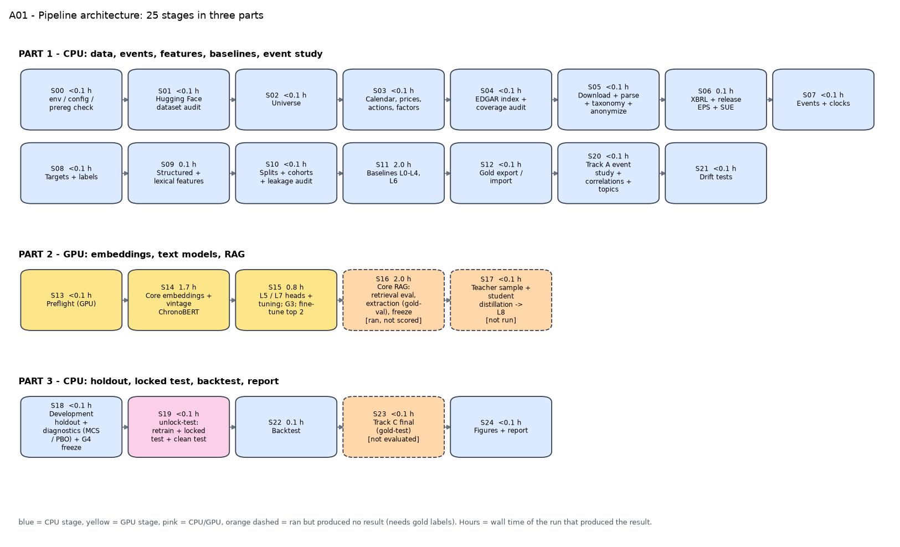

*A01 Pipeline architecture: 25 stages in three parts.* System architecture: the 25 stages in three parts (CPU data and baselines, GPU embeddings and RAG, CPU holdout/locked test/report) with the wall time of the run that produced each result. Orange dashed = ran but produced no result because gold labels are missing.

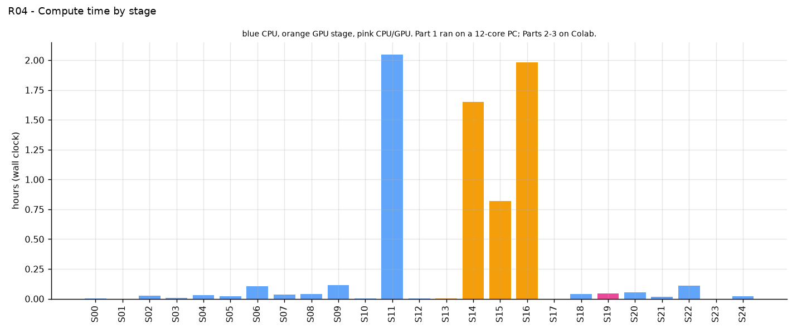

*R04 Compute time by stage.* Wall-clock hours per stage. Part 1 ran on a 12-core PC, Parts 2 and 3 on Colab.

### A3. Data sources and universe
| source | used for | scope in this run | access |
|---|---|---|---|
| SEC EDGAR (10-K, 10-Q, 8-K, EX-99 exhibits) | all study text; filing lists and acceptance times (SGML header, else submissions JSON) | 10-K: 3,807 filings, 3,802 parsed; 10-K405: 212 filings, 212 parsed; 10-Q: 11,949 filings, 11,777 parsed; 8-K: 48,245 filings, 48,142 parsed | public; User-Agent from the environment, <= 6 requests/s |
| EDGAR XBRL company facts | accounting features, quarterly EPS as first reported, SUE | 304,348 facts, 14 tags | public |
| Earnings-release exhibits (EX-99) | release EPS parsed for SUE and verified earnings dates | 19,050 exhibit rows, 14,981 results releases; 27,756 filings, SUE available for 18,750 | parsed from EDGAR |
| Hugging Face SEC corpus JanosAudran/financial-reports-sec | firm overlap with the study universe and parser QA only, never the study text (10-K only) | revision 5da7e3c8b9 | public dataset |
| Daily prices (OHLCV): owner's local files, spliced with Yahoo Finance | returns, volatility, price features, benchmark and backtest | 1998-01-02 to 2026-10-09; 1,024,405 daily bars for 150 firms | local files + yfinance (auto_adjust off; actions kept) |
| Fama-French / Carhart factors and the 12-industry map | Carhart alpha in the backtest, industry grouping | factor files in the inputs folder (ff5, momentum, Siccodes12) | Kenneth French data library |
| S&P 500 membership history fja05680/sp500 | index bucket and point-in-time membership flag | 150 firms, all ever members in the window | public GitHub list, pinned commit |
| Loughran-McDonald master dictionary 1993-2025 | lexical tone features | sha256 pinned | academic use |

**Universe.** 150 firms: S&P 500 members at some point between 2000-01-01 and 2026-07-31, drawn with a fixed seed and stratified by Fama-French industry from the eligible set (a firm needs prices in the local files and at least one 10-K in the Hugging Face corpus). All 150 are *current* listings, so the sample is survivor-only (see limitations). The eligible data covers about 353 of the 1094 tickers that were ever S&P 500 members in the window.

**Tickers by industry**

- **BusEq** (26): ADBE, ADI, ADSK, AMAT, ANET, CDNS, CIEN, CRWD, ENPH, FDS, FLEX, HPQ, ILMN, INTU, MCHP, META, MSFT, MTD, MU, NOC, ORCL, SWKS, TMO, TRMB, VRSN, XYZ
- **Other** (25): CCL, CLF, CRL, EBAY, EFX, FDX, FIS, LEN, LYV, MGM, NEM, ODFL, OMC, PAYX, PENN, PHM, RCL, ROL, RSG, UBER, UNP, UPS, V, VMC, WYNN
- **Manuf** (19): ATI, CAT, DECK, GD, GE, GLW, IEX, ITT, KMB, LII, MAS, NDSN, NKE, NOV, PH, PKG, SNA, TEX, TKR
- **Shops** (19): AAP, AMZN, ANF, ASH, CASY, COST, DRI, FAST, GME, GPC, HD, HSIC, MCD, SBUX, SYY, TGT, TJX, TSCO, URBN
- **Money** (17): AMT, AXP, CPT, EQIX, ESS, EXR, GNW, ICE, LNC, MAC, MBI, MKTX, MOH, MTG, PGR, UDR, UNH
- **Hlth** (14): ALGN, AMGN, BAX, BIIB, COO, DXCM, GILD, ISRG, JNJ, LH, LLY, PFE, REGN, STE
- **NoDur** (9): CAG, DLX, GIS, HRL, HSY, KO, MAT, TSN, VFC
- **Utils** (7): AEE, EIX, ETR, EXC, FE, OKE, WMB
- **Chems** (5): APD, ECL, EL, EMN, PPG
- **Enrgy** (5): CNX, EQT, MUR, RRC, SLB
- **Durbl** (3): AYI, TSLA, WHR
- **Telcm** (1): VZ

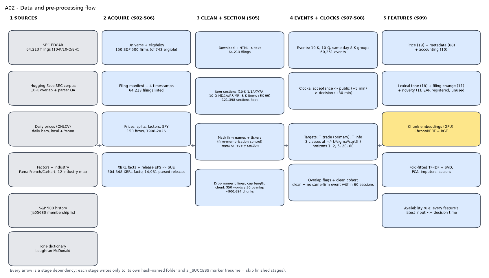

*A02 Data and pre-processing flow.* Data and pre-processing flow from sources to features; counts are read from the run.

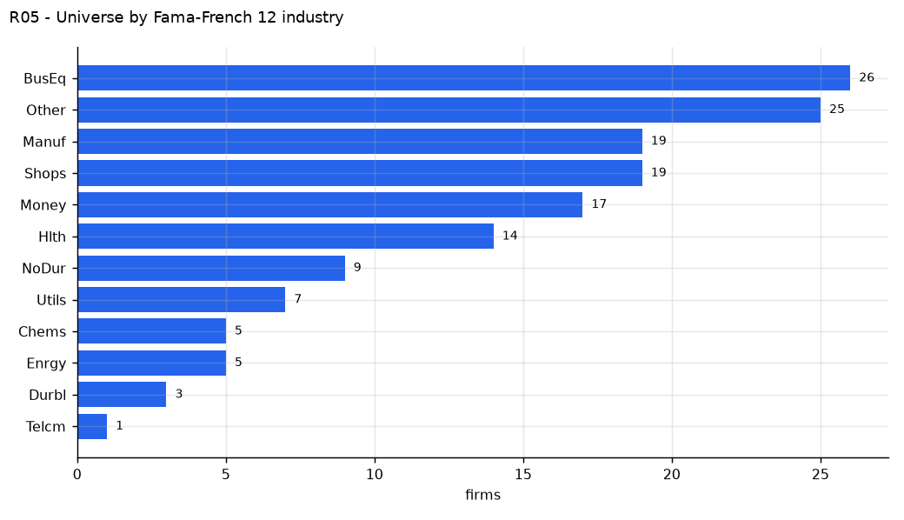

*R05 Universe by Fama-French 12 industry.* Universe: number of firms per Fama-French 12 industry.

### A4. Pre-processing and NLP pipeline
Text is cleaned, sectioned, masked and chunked identically for every model, so differences between encoders cannot come from different inputs.

| step | what is done | measured in this run |
|---|---|---|
| 1 Download | Full-submission text per filing from EDGAR (SGML header read for every filing; exhibits for 8-K). Requests are rate-limited, cached on disk (compressed) and retried per filing. | 64,213 filings processed; 63,933 parsed ok, 280 without a target section |
| 2 HTML to text | HTML / SGML to normalised plain text; tables are flattened to 'cell / cell' rows so numeric parsers can read them; page-number and table-border debris is removed. | 2,550,579 tables flattened |
| 3 Section extraction | Headings found by item number plus title keywords; of several candidate starts (table-of-contents lines repeat headings) the longest span wins; sections incorporated by reference are flagged and recovered from EX-13 where possible. Targets: 10-K: 10K_1, 10K_1A, 10K_7, 10K_7A; 10-Q: 10Q_MDA, 10Q_MR, 10Q_RF; 8-K: 8K_ITEMS, 8K_EX99. | 121,398 sections kept |
| 4 Firm-name masking | The firm's own legal names, former names and tickers are masked in every section (firm-memorisation control, leakage item 4). A named-entity masker (bert-base-NER) exists for the GPU stage and is off by default. | 881,908 firm-name and 249,224 ticker replacements |
| 5 Numeric-line filter and caps | Numeric-heavy lines are dropped from narrative text (drop_numeric_lines=True); each section is capped at 300,000 characters and the text passed to models at 12,000 characters. | 278 sections hit the cap |
| 6 Chunking | Sliding windows of 350 words with 50 words overlap, at most 24 chunks per section; the same chunks feed every encoder and the retriever. | about 900,694 chunks, 474,394,039 tokens (preflight estimate) |
| 7 Tokenisation | Each encoder's own tokenizer, truncated to 512 tokens; batches are length-sorted (batch 128, halved automatically on out-of-memory). | - |
| 8 Pooling to event vectors | Chunk vectors are mean- and max-pooled to section vectors; an event vector is the chunk-weighted mean of its section means; the 'change' vector is the cosine to the firm's previous event of the same type (decision time strictly earlier). | 60,030 events embedded per encoder |
| 9 Classic text features | Loughran-McDonald tone counts, filing-change similarity (fixed hashing space, so no vocabulary is learned from future data) and a novelty share; fold-fitted TF-IDF + SVD features are added inside each training fold only. | see feature table |

**Sections kept, by section id**

| section_id | sections | median_tokens | truncated | by_reference |
|---|---|---|---|---|
| 10K_1 | 3,786 | 7712.500 | 1 | 16 |
| 10K_1A | 2,654 | 9557.500 | 0 | 19 |
| 10K_7 | 3,998 | 13734.000 | 39 | 78 |
| 10K_7A | 3,882 | 627.000 | 0 | 557 |
| 10Q_MDA | 11,684 | 8815.500 | 9 | 0 |
| 10Q_MR | 9,764 | 166.000 | 0 | 666 |
| 10Q_RF | 7,128 | 126.000 | 0 | 542 |
| 8K_EX99 | 30,437 | 3010.000 | 228 | 0 |
| 8K_ITEMS | 48,065 | 252.000 | 1 | 0 |

### A5. Events, clocks, targets and labels
**Events.** 60,261 events (8K 45,193, periodic_10Q 11,271, periodic_10K 3,797). Same-firm, same-day 8-Ks are merged into one multi-label event whose clock is the LAST acceptance of the group (found as a look-ahead leak in the full-scale run, decision D-071). **Four timestamps** per event: acceptance, assumed public time (+5 min), feature-ready time and decision time (+30 min). Timestamp quality A 57,817, B 1,672, C 772 (A = exact from the SGML header, B = date only, C = uncertain). Session buckets: POST 32,689, INTRA 14,373, PRE 12,927, NONTRADING 272 (PRE = before the open, INTRA = during the session, POST = after the close).

**Targets.** T_trade (primary): entry at the open of the first session whose open is at or after the decision time, exit at the close of session entry + h - 1 (an executable open-to-close return); abnormal return = stock return minus beta x SPY return on the identical interval (no close-to-close factor return is ever subtracted from an open-to-close return, so Carhart abnormal returns are null for T_trade). Beta comes from a market model estimated on sessions -250 to -30 before the event (at least 120 observations). T_info is the information response: close-to-close from the last close at or before acceptance to the close of the h-th session after public time (INTRA events excluded). Horizons: 1, 2, 5, 20, 60 sessions. Labels: Up/Down beyond k x sigma x sqrt(h) with k = 0.5 (sensitivity 0.25 and 0.75). Class shares of the primary labels: Down 0.294, Sideways 0.405, Up 0.300. Events after the usable cutoff are censored per horizon. **Overlap:** an event is 'clean' if the firm has no other event within 60 sessions; flags exist per horizon and ignore members of the event's own cluster (decision D-073).

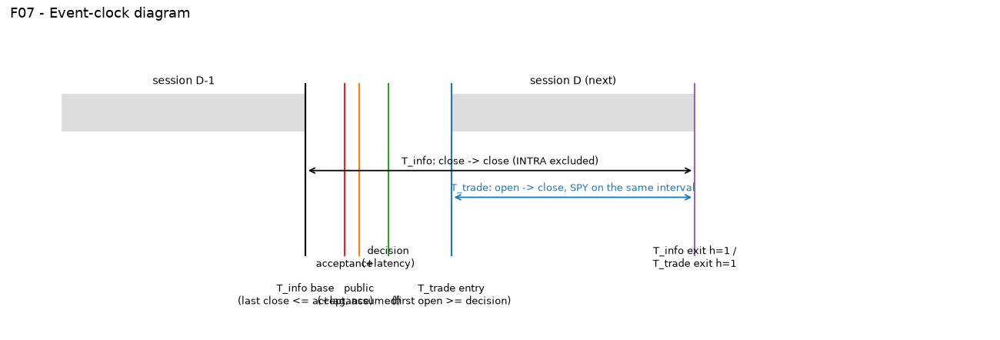

*F07 Event-clock diagram.* Event-clock diagram: acceptance, assumed public time, decision time; T_info base/exit; T_trade entry/exit.

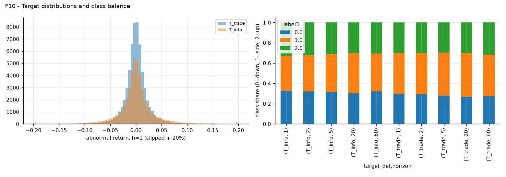

*F10 Target distributions and class balance.* Target distributions (abnormal returns) and 3-class balance by target definition.

### A6. Features and the ablation ladder
Features are grouped in families; each family carries an availability column and the rule `latest input <= decision time` is asserted for every event (0 violations in this run). The ablation ladder adds information step by step and every comparison uses identical events (the 'common cohort').

| family | features | examples | source | availability | leaderboard |
|---|---|---|---|---|---|
| accounting | 10 | acc_log_assets, acc_leverage, acc_roa, acc_log_revenue | S06 | XBRL/release values with public_time < decision_time; SUE never from a later same-cluster accession | strict |
| change | 11 | chg_cosine, chg_jaccard_sent, chg_log_len, chg_lm_negative | S05 sections | prior same-firm documents with public_time < decision_time | strict |
| ear | 1 | ear_last | S08/S20 | EAR of a later, different cluster whose window closed before decision_time | strict |
| lexical | 18 | lm_negative, lm_positive, lm_uncertainty, lm_litigious | S05 sections | own filing text | strict |
| metadata | 68 | meta_type_periodic_10K, meta_type_periodic_10Q, meta_type_8K, meta_cat_OTHER_OR_UNMAPPED | manifest/events | own filing metadata (acceptance <= decision) | strict |
| novelty | 1 | novelty_share | S05 sections | prior same-firm documents with public_time < decision_time | strict |
| price | 19 | px_ret_1, px_ret_5, px_ret_20, px_ret_60 | prices (S03) | closes at or before decision_time | strict |

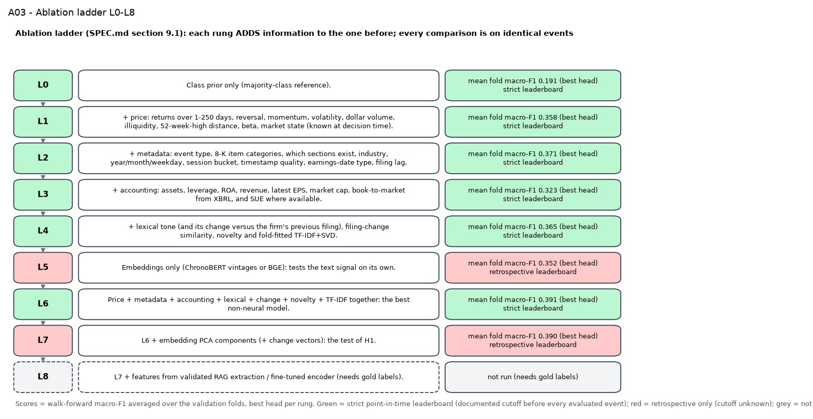

*A03 Ablation ladder L0-L8.* The ablation ladder L0-L8: what each rung adds, its walk-forward macro-F1, and whether it is on the strict (green) or retrospective (red) leaderboard.

### A7. Models, encoders and training
**Encoders (frozen, used to embed filing chunks).**

| encoder | model | training data | cutoff | pooling | in this run |
|---|---|---|---|---|---|
| sec_bert | nlpaueb/sec-bert-base | 260,773 10-K filings 1993-2019 (model card) | 2019-12-31 | mean | no (fast mode) |
| finbert_tone | yiyanghkust/finbert-tone | 10-K/10-Q (2.5B tokens), earnings calls (1.3B), analyst reports (1.1B); tone fine-tune on analyst-report sentences | unknown | mean | no (fast mode) |
| chrono_bert | manelalab/chrono-bert-v1-{year}1231 | timestamped open-source text; each vintage trained only on text up to its date | vintage | mean | yes |
| bge_base | BAAI/bge-base-en-v1.5 | general web-scale text (card); no date cutoff stated | unknown | cls | yes |

Why these: ChronoBERT gives a point-in-time encoder (event year Y uses the vintage trained to the end of year Y-1; 26 vintages with pinned revisions), so its results can go on the strict leaderboard; BGE-base is a strong general-purpose encoder that also serves as the dense retriever; SEC-BERT (10-K domain) and FinBERT-tone (tone) are in the spec's core roster but were **dropped in this run to save time (fast mode, decision D-074); this was a time decision, not a measured result**.

**Heads (trained on the features and embeddings).** LightGBM and CatBoost (gradient-boosted trees) and an elastic-net logistic regression. Trees capture interactions and non-linearities in tabular data; the elastic net is a convex, regularised reference whose optimum can be certified. CatBoost was used for the structured baselines but not for the embedding stage (fast mode). 

**Training.** Loss: class-weighted cross-entropy (balanced class weights x label-uniqueness weights, so overlapping events count less). Early stopping and probability calibration use an inner, time-ordered slice of each training fold. Hyperparameters: Optuna (TPE sampler, median pruner), tuned on the most recent 3 walk-forward folds with at most 30,000 training rows per fold, then the chosen setting is refitted on every fold. Decision rule: probabilities are corrected back to true frequencies and the class is `argmax p(c|x) / prior(c)`, which keeps predicted classes balanced. Fold-level preprocessing (TF-IDF + SVD, embedding PCA, imputers, scalers, calibration, clip bounds) is fitted on the training rows of that fold only. Fine-tuning of the encoders is allowed only if gate G3 passes; here it did not, so no encoder was fine-tuned.

**Tuned hyperparameters**

| model | tuned hyperparameters |
|---|---|
| L1/lightgbm | {"learning_rate": 0.0224, "num_leaves": 18, "min_child_samples": 22, "subsample": 0.7589, "colsample_bytree": 0.4989, "reg_alpha": 0.133, "reg_lambda": 0.0129, "max_depth": 6} |
| L1/catboost | {"learning_rate": 0.0778, "depth": 8, "l2_leaf_reg": 1.0508, "random_strength": 1.5873} |
| L1/enet | {"C": 0.0064, "l1_ratio": 0.4408} |
| L2/lightgbm | {"learning_rate": 0.0686, "num_leaves": 86, "min_child_samples": 322, "subsample": 0.5935, "colsample_bytree": 0.9324, "reg_alpha": 0.3372, "reg_lambda": 3.5502, "max_depth": 6} |
| L2/catboost | {"learning_rate": 0.0778, "depth": 8, "l2_leaf_reg": 1.0508, "random_strength": 1.5873} |
| L2/enet | {"C": 0.1, "l1_ratio": 0.5} |
| L3/lightgbm | {"learning_rate": 0.0783, "num_leaves": 91, "min_child_samples": 86, "subsample": 0.5008, "colsample_bytree": 0.6289, "reg_alpha": 5.812, "reg_lambda": 0.0059, "max_depth": 4} |
| L3/catboost | {"learning_rate": 0.05, "depth": 6, "l2_leaf_reg": 3.0, "random_strength": 1.0} |
| L3/enet | {"C": 0.0012, "l1_ratio": 0.7067} |
| L4/lightgbm | {"learning_rate": 0.0817, "num_leaves": 64, "min_child_samples": 331, "subsample": 0.6879, "colsample_bytree": 0.8893, "reg_alpha": 0.1691, "reg_lambda": 9.6351, "max_depth": 6} |
| L4/catboost | {"learning_rate": 0.0778, "depth": 8, "l2_leaf_reg": 1.0508, "random_strength": 1.5873} |
| L4/enet | {"C": 0.1, "l1_ratio": 0.5} |
| L6/lightgbm | {"learning_rate": 0.0803, "num_leaves": 25, "min_child_samples": 158, "subsample": 0.8007, "colsample_bytree": 0.5189, "reg_alpha": 1.3237, "reg_lambda": 1.3292, "max_depth": -1} |
| L6/catboost | {"learning_rate": 0.0778, "depth": 8, "l2_leaf_reg": 1.0508, "random_strength": 1.5873} |
| L6/enet | {"C": 0.0064, "l1_ratio": 0.4408} |
| L7/lightgbm/chrono_bert | {"learning_rate": 0.0693, "num_leaves": 13, "min_child_samples": 74, "subsample": 0.7459, "colsample_bytree": 0.4964, "reg_alpha": 1.1075, "reg_lambda": 7.2247, "max_depth": -1} |
| L7/enet/chrono_bert | {"C": 0.1, "l1_ratio": 0.5} |
| L7/lightgbm/bge_base | {"learning_rate": 0.0693, "num_leaves": 13, "min_child_samples": 74, "subsample": 0.7459, "colsample_bytree": 0.4964, "reg_alpha": 1.1075, "reg_lambda": 7.2247, "max_depth": -1} |
| L7/enet/bge_base | {"C": 0.1, "l1_ratio": 0.5} |

The elastic net's convex problem has a certified global optimum; tree models are validation-selected, never claimed to be global optima. **Search budget.** Each Optuna study first tries the default setting, then draws candidates with a fixed seed. Baseline stage (S11): lightgbm 15, catboost 6, enet 8 trials per study; embedding stage (S15): lightgbm 8, enet 4 trials per study (fast mode). Optuna's TPE sampler draws its first 10 candidates at random, so every study with fewer than 10 trials (CatBoost and elastic-net in S11, everything in S15 under fast mode) is a small random search that sees the SAME random candidates in every rung and encoder. That is why several rungs share identical settings in the table (for example the two L7/LightGBM rows) and why 'tuned' is often equal to 'default' (see 'Tuning: default vs tuned'). Tuning gains are small by design and should not be read as a search for the best possible model.

### A8. RAG and structured-extraction system
The RAG system turns a filing into structured, evidence-cited events (guidance change, impairment, restructuring, M&A, dividends, liquidity stress, litigation, management change and so on; 12 fields in question bank v1). It has two retrieval paths: the **current-document path** (chunks of the filing being processed, allowed at decision time) and a **historical path** (the firm's earlier filings with public time strictly before decision time; the current or any later filing can never enter; checked by a self-test and a planted leak). In S16 all 12 questions are asked together as one query, the top 8 passages are retrieved (BM25 k1 1.5, b 0.75; dense BGE; reciprocal-rank fusion k 60; cross-encoder rerank of the top 30) and Qwen2.5-7B-Instruct, run locally with JSON-schema-constrained decoding, fills the 12 fields. Guardrails: schema validation with one retry; a numeric magnitude must appear in its cited evidence; every quote must be a substring of its cited chunk or the field is set to null; citation offsets are verified. Responses are cached by model revision, prompt and passages.

**What ran in this study.** Qwen produced pre-filled annotation templates for 149 development/validation filings (141 returned a valid structured response) (47.16 s per filing, 2.0 h). Gold-test filings were never sent to the model. **What could not run:** there are no human gold labels (status: single-rater, provisional; imported: False), so the retrieval tournament (BM25 vs hybrid vs hybrid+rerank), extraction F1, faithfulness and numeric-fidelity evaluation (F32-F36), gate G3b (passed: False; reason: no gold-val labels), the teacher/student distillation (S17) and feature set L8 were not produced, and H3 and H6 are untested. The model outputs below are therefore **not evidence of extraction quality**; they only show what the pipeline produces.

**How often each field was extracted as present** (descriptive; unvalidated)

| field | filings | extracted_present | high_certainty_when_present |
|---|---|---|---|
| buyback | 141.000 | 10.6% | 100.0% |
| dividend | 141.000 | 6.4% | 100.0% |
| financing_covenant | 141.000 | 7.1% | 90.0% |
| guidance | 141.000 | 18.4% | 100.0% |
| impairment | 141.000 | 4.3% | 66.7% |
| liquidity_stress | 141.000 | 0.0% | n/a |
| litigation_regulatory | 141.000 | 2.1% | 100.0% |
| management_change | 141.000 | 15.6% | 90.9% |
| mna | 141.000 | 12.8% | 94.4% |
| restructuring | 141.000 | 10.6% | 86.7% |
| results_tone | 141.000 | 16.3% | 95.7% |
| risk_factor_change | 141.000 | 19.9% | 89.3% |

**One real extraction (illustration only; unvalidated model output on a development filing).**
- **guidance**: initiated (certainty high, magnitude 0 $M); evidence: "For the second quarter ending October 1, 2010, revenue is expected to be in the range of $6.8 billion to $7.2 billion and adjusted EPS is expected to be in the range of $0.19 to $0.21 per share. GAAP earnings per share a"
- **results_tone**: beat (certainty high, magnitude 0 %); evidence: "Net sales rose 14% year-over-year and 11% sequentially Adjusted EPS increased 138% year-over-year and 19% sequentially"
- **impairment**: recorded (certainty medium, magnitude 0 $M); evidence: "During the three-month period ended July 3, 2009, the Company impair"
- **restructuring**: announced (certainty high, magnitude 0 $M); evidence: "The Company’s restructuring activities, which include employee severance, costs related to owned and leased facilities and equipment that are no longer in use and are to be disposed of, and other costs associated with th"
- **buyback**: authorized (certainty high, magnitude 135 $M); evidence: "During the quarter we repurchased $135 million of stock on our $200 million authorization"
- **risk_factor_change**: new (certainty high, magnitude 0 ); evidence: "Add • the effects that the current macroeconomic environment could have on our business and demand for our products as well as on our liquidity and our ability to access credit markets; and • the effects that current cre"

Read the quotes against the fields yourself: without gold labels nothing here is checked, and typical flaws are a magnitude left at 0 when a range is quoted, a quote cut off mid-sentence, or a generic sentence offered as evidence of a change.

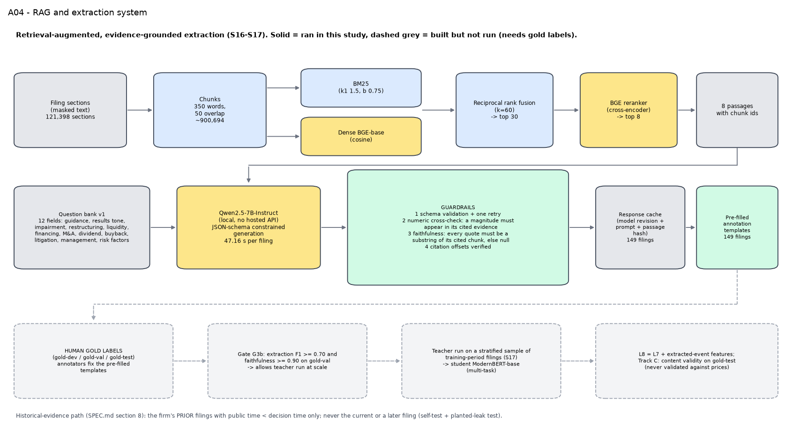

*A04 RAG and extraction system.* The retrieval-augmented extraction system: retrieval (BM25 + dense + fusion + rerank), constrained generation, guardrails, cache and annotation templates; dashed grey stages need human gold labels and were not run.

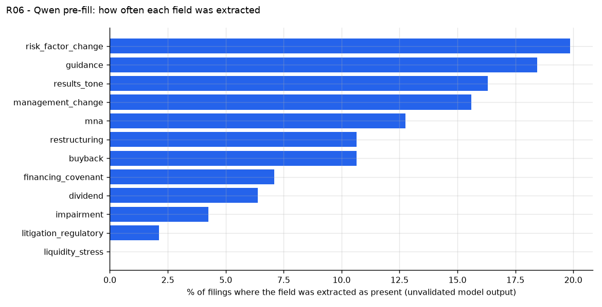

*R06 Qwen pre-fill: how often each field was extracted.* Share of pre-filled filings in which Qwen extracted each field as present. Unvalidated model output (no gold labels), shown only to describe what the pipeline produces.

### A9. Evaluation design: splits, metrics and statistics
**Splits.** Expanding walk-forward validation folds (training starts in 2000, first fold needs at least 8 years, validation blocks of 2 years), then a development holdout, then the locked test. Events whose outcome window reaches the next block are purged and a 90-day embargo separates blocks. Models selected on the walk-forward folds are retrained on all earlier data before the development holdout; the final choice is frozen and hashed (G4) before the locked test, which is scored once.

| block | role | from | to (exclusive) | events |
|---|---|---|---|---|
| wf0 | validation fold (train on everything earlier) | 2008-01-01 | 2010-01-01 | 5,026 |
| wf1 | validation fold (train on everything earlier) | 2010-01-01 | 2012-01-01 | 4,951 |
| wf2 | validation fold (train on everything earlier) | 2012-01-01 | 2014-01-01 | 4,874 |
| wf3 | validation fold (train on everything earlier) | 2014-01-01 | 2016-01-01 | 4,978 |
| wf4 | validation fold (train on everything earlier) | 2016-01-01 | 2018-01-01 | 4,937 |
| wf5 | validation fold (train on everything earlier) | 2018-01-01 | 2020-01-01 | 4,807 |
| dev | development holdout: choose the final model | 2020-01-01 | 2023-01-01 | 7,455 |
| locked | locked test: scored once after the freeze | 2023-01-01 | 2026-08-01 | 8,213 |

**Leakage controls.** A 24-item checklist with an assertion per item, plus four planted leaks (a future-return feature, a same-event EAR, a later-cluster SUE, a future document in retrieval) that the audit must catch; all four were caught.

**Metrics and statistics**

| metric | why it is used | where it appears |
|---|---|---|
| Macro-F1 (primary) | Down/Sideways/Up classes are roughly balanced and equally important; macro-F1 weights them equally and cannot be inflated by predicting only the biggest class. | all prediction tables |
| Accuracy, balanced accuracy | Plain and class-balanced hit rate; accuracy alone rewards the majority class. | ladder, holdout, locked test |
| AUC (one-vs-rest, macro) | Ranking quality of the probabilities, independent of the decision threshold. | ladder, section 5a |
| Log-loss and Brier score | Quality of the probabilities themselves; a model must beat the class prior (pre-registered guardrail). | guardrails table |
| Expected calibration error (ECE) | Whether predicted probabilities match observed frequencies; guardrail ECE <= 0.10. | guardrails, calibration figure |
| Move AUC and direction AUC | Separates 'will the stock move?' from 'which way?' (section 5a). | section 5a |
| Month-block bootstrap CI | Events in one month share market shocks; resampling whole months keeps that dependence. Paired versions resample the same months for two models. | every CI |
| Benjamini-Hochberg FDR | Controls the false-discovery rate within pre-declared families of Track A tests. | Track A tables |
| Two-way clustered errors | Track A standard errors cluster by firm and by date. | Track A tables |
| Deflated Sharpe, Carhart alpha | Backtest sanity: Sharpe corrected for the number of configurations tried; alpha after market, size, value and momentum. | backtest |
| Permutation null, adversarial AUC | Sanity checks: does the pipeline score above chance only when labels are real, and are train and validation periods separable? | section 3 |
| MCS and PBO | Model Confidence Set and Probability of Backtest Overfitting; diagnostics only, they never select a model. | section 3, F40 |

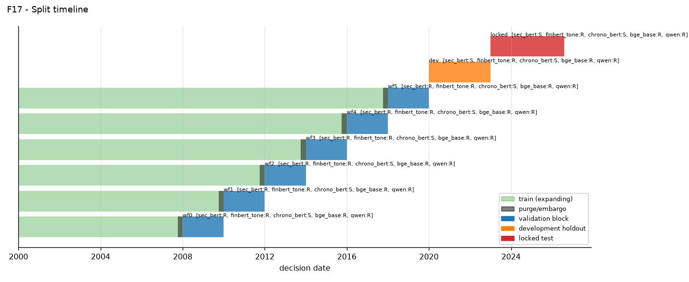

*F17 Split timeline.* Split timeline: walk-forward validation blocks, purge/embargo gap, development holdout, locked test; per-fold strict/retrospective labels.

## 1. Data integrity
Universe: **150 unique firms** (target 150) common to our OHLCV files and the HF 10-K corpus: **150 S&P 500 members** (at some point in 2000-01-01 to 2026-07-31, fja05680/sp500 @ a2430f2a), drawn seeded and sector-stratified from the eligible S&P members: an S&P-only study (no non-S&P comparison). **Survivor-only:** every firm is a current listing, so firms that delisted, merged or were acquired before 2026 are absent (survivorship-biased; drift and backtest results are biased towards survivors); the eligible data covers about 353 of the 1094 tickers that were S&P 500 members in the window (32%, ticker-level, approximate), of which this study uses 150. Candidates: 979; eligible: 743. Exclusions: {'not_in_hf_10k_corpus': 236}. Usable cutoff 2026-07-31 (last price 2026-10-09, last document 2026-07-31); final month partial: False. Firms per year are reported separately below; 500 firms per year is never claimed.

### Universe by year
| year | firms_with_prices | firms_in_sp500 | unique_firms |
|---|---|---|---|
| 2000 | 129 | 74 | 150 |
| 2001 | 132 | 75 | 150 |
| 2002 | 134 | 75 | 150 |
| 2003 | 136 | 76 | 150 |
| 2004 | 139 | 78 | 150 |
| 2005 | 142 | 83 | 150 |
| 2006 | 142 | 88 | 150 |
| 2007 | 142 | 94 | 150 |
| 2008 | 143 | 99 | 150 |
| 2009 | 143 | 99 | 150 |
| 2010 | 144 | 99 | 150 |
| 2011 | 144 | 99 | 150 |
| 2012 | 146 | 98 | 150 |
| 2013 | 146 | 100 | 150 |
| 2014 | 147 | 102 | 150 |
| 2015 | 148 | 106 | 150 |
| 2016 | 148 | 109 | 150 |
| 2017 | 148 | 111 | 150 |
| 2018 | 148 | 111 | 150 |
| 2019 | 150 | 113 | 150 |
| 2020 | 150 | 113 | 150 |
| 2021 | 150 | 118 | 150 |
| 2022 | 150 | 122 | 150 |
| 2023 | 150 | 122 | 150 |
| 2024 | 150 | 123 | 150 |
| 2025 | 150 | 121 | 150 |
| 2026 | 150 | 121 | 150 |

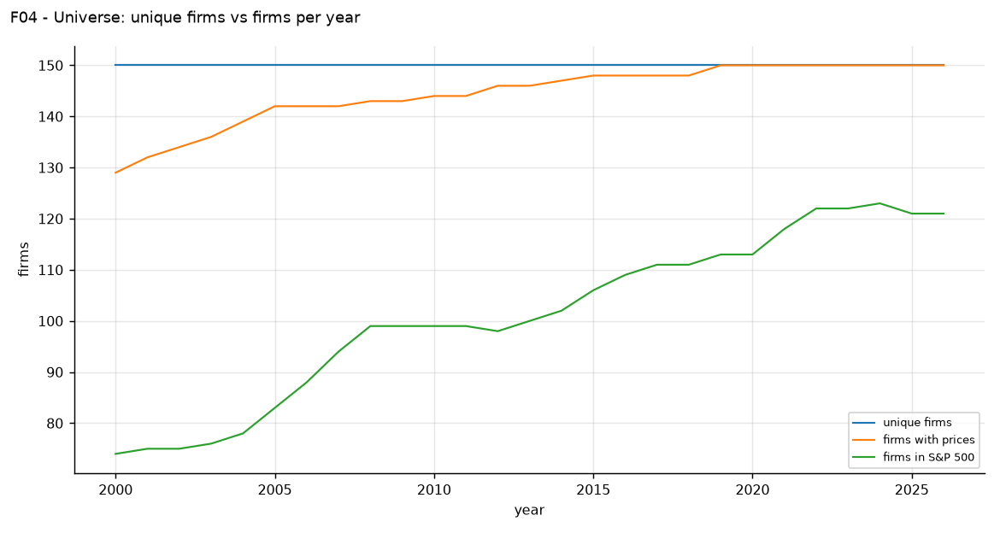

*F04 Universe: unique firms vs firms per year.* Universe: unique firms (constant) vs firms with prices and firms in the S&P 500 each year. Survivor-only universe (current listings; survivorship-biased).

### Filing coverage (observed vs parsed) and audit reason codes
| base_form | observed | parsed | parsed_share |
|---|---|---|---|
| 10-K | 3,807 | 3,802 | 0.999 |
| 10-K405 | 212 | 212 | 1.000 |
| 10-Q | 11,949 | 11,777 | 0.986 |
| 8-K | 48,245 | 48,142 | 0.998 |
| reason_code | firm_years |
|---|---|
| OK | 3530 |
| MISSING_10K | 188 |
| 10Q_COUNT_0 | 91 |
| EXTRA_10K_POSSIBLE_TRANSITION | 48 |
| 10Q_COUNT_2 | 32 |
| 10Q_COUNT_1 | 26 |
| 10Q_COUNT_4 | 22 |

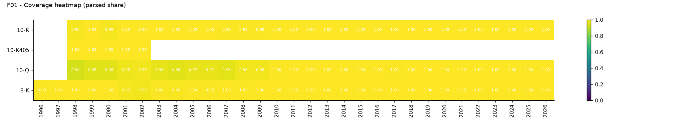

*F01 Coverage heatmap (parsed share).* Coverage heatmap: share of observed filings that parsed into at least one section, by year x form. Pale cells = parser or download gaps.

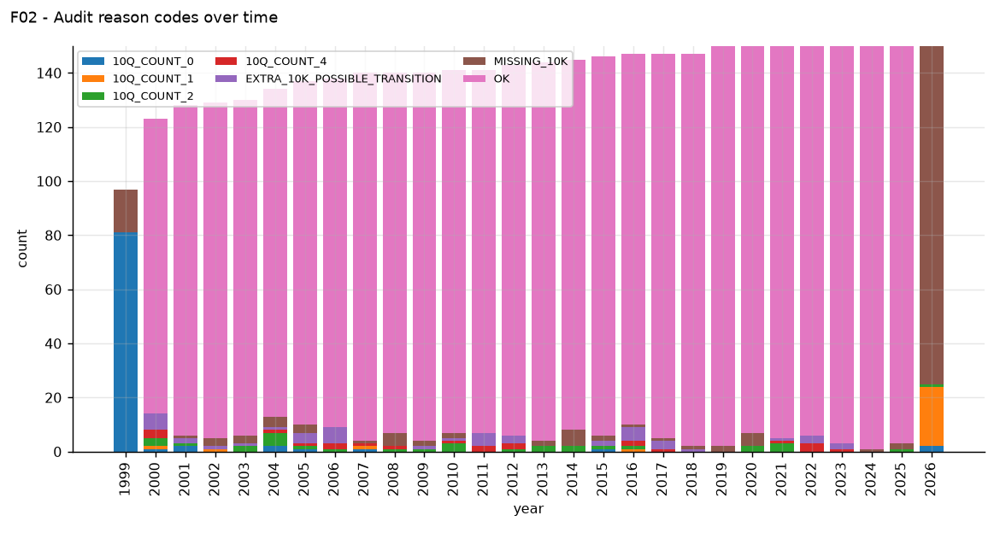

*F02 Audit reason codes over time.* Audit reason codes by year (periodic-filing expectations only; 8-Ks have no expectation).

### 8-K category availability (taxonomy v1)
| category | 2000 | 2001 | 2002 | 2003 | 2004 | 2005 | 2006 | 2007 | 2008 | 2009 | 2010 | 2011 | 2012 | 2013 | 2014 | 2015 | 2016 | 2017 | 2018 | 2019 | 2020 | 2021 | 2022 | 2023 | 2024 | 2025 | 2026 |
|---|---|---|---|---|---|---|---|---|---|---|---|---|---|---|---|---|---|---|---|---|---|---|---|---|---|---|---|
| OTHER_OR_UNMAPPED | 0 | 0 | 0 | 0 | 1 | 0 | 0 | 0 | 0 | 0 | 0 | 0 | 0 | 0 | 0 | 0 | 0 | 0 | 0 | 0 | 0 | 0 | 0 | 0 | 0 | 0 | 0 |
| acquisition_disposition | 49 | 27 | 23 | 16 | 30 | 31 | 23 | 31 | 26 | 9 | 20 | 24 | 20 | 27 | 30 | 26 | 29 | 24 | 28 | 28 | 16 | 20 | 13 | 13 | 14 | 7 | 8 |
| auditor_change | 3 | 5 | 35 | 5 | 7 | 9 | 6 | 4 | 1 | 1 | 1 | 0 | 0 | 5 | 4 | 0 | 2 | 1 | 1 | 1 | 5 | 0 | 1 | 2 | 2 | 3 | 0 |
| bankruptcy | 0 | 0 | 0 | 0 | 0 | 1 | 0 | 0 | 0 | 0 | 0 | 0 | 0 | 0 | 0 | 0 | 0 | 0 | 1 | 0 | 0 | 0 | 0 | 0 | 0 | 0 | 0 |
| benefit_plan_blackout | 0 | 0 | 0 | 5 | 6 | 5 | 8 | 7 | 4 | 3 | 6 | 4 | 1 | 3 | 0 | 5 | 5 | 1 | 3 | 6 | 2 | 0 | 1 | 2 | 2 | 2 | 0 |
| bylaws_fiscal_year | 0 | 0 | 3 | 2 | 21 | 51 | 71 | 86 | 103 | 68 | 60 | 58 | 66 | 65 | 47 | 73 | 77 | 59 | 46 | 45 | 59 | 57 | 54 | 71 | 61 | 47 | 28 |
| control_change | 20 | 6 | 1 | 0 | 3 | 0 | 3 | 1 | 0 | 1 | 1 | 0 | 1 | 0 | 0 | 0 | 1 | 0 | 2 | 1 | 2 | 1 | 0 | 0 | 1 | 0 | 1 |
| cybersecurity | 0 | 0 | 0 | 0 | 0 | 0 | 0 | 0 | 0 | 0 | 0 | 0 | 0 | 0 | 0 | 0 | 0 | 0 | 0 | 0 | 0 | 0 | 0 | 1 | 2 | 0 | 1 |
| delisting | 0 | 0 | 0 | 0 | 0 | 8 | 11 | 10 | 2 | 2 | 1 | 1 | 3 | 2 | 2 | 2 | 0 | 1 | 1 | 2 | 1 | 0 | 0 | 2 | 4 | 2 | 1 |
| director_nomination | 0 | 0 | 0 | 0 | 0 | 0 | 0 | 0 | 0 | 0 | 0 | 0 | 0 | 0 | 0 | 0 | 0 | 2 | 1 | 1 | 0 | 0 | 0 | 0 | 0 | 1 | 0 |
| earnings | 0 | 0 | 0 | 183 | 569 | 620 | 620 | 606 | 652 | 621 | 621 | 607 | 638 | 637 | 622 | 620 | 628 | 619 | 617 | 631 | 663 | 634 | 627 | 636 | 638 | 629 | 419 |
| ethics_code | 0 | 0 | 0 | 0 | 2 | 7 | 6 | 3 | 2 | 3 | 2 | 0 | 4 | 2 | 1 | 0 | 0 | 0 | 0 | 2 | 0 | 1 | 0 | 2 | 0 | 0 | 0 |
| exhibits | 271 | 335 | 480 | 703 | 951 | 1,494 | 1,538 | 1,562 | 1,479 | 1,461 | 1,449 | 1,391 | 1,398 | 1,371 | 1,435 | 1,452 | 1,411 | 1,431 | 1,375 | 1,372 | 1,678 | 1,536 | 1,315 | 1,365 | 1,284 | 1,308 | 778 |
| financial_obligation | 0 | 0 | 0 | 0 | 43 | 109 | 83 | 108 | 67 | 64 | 75 | 103 | 98 | 96 | 93 | 109 | 102 | 111 | 105 | 105 | 189 | 149 | 85 | 100 | 99 | 120 | 63 |
| impairment | 0 | 0 | 0 | 0 | 4 | 13 | 12 | 14 | 8 | 23 | 10 | 5 | 11 | 15 | 6 | 7 | 8 | 7 | 5 | 3 | 5 | 3 | 2 | 0 | 2 | 2 | 2 |
| management_change | 0 | 1 | 0 | 0 | 70 | 265 | 261 | 475 | 432 | 377 | 353 | 343 | 358 | 372 | 354 | 390 | 354 | 355 | 411 | 372 | 384 | 383 | 361 | 367 | 338 | 406 | 229 |
| material_agreement | 0 | 0 | 0 | 0 | 149 | 640 | 532 | 275 | 201 | 187 | 190 | 213 | 207 | 198 | 214 | 242 | 215 | 209 | 196 | 191 | 292 | 240 | 147 | 175 | 171 | 174 | 99 |
| mine_safety | 0 | 0 | 0 | 0 | 0 | 0 | 0 | 0 | 0 | 0 | 0 | 0 | 16 | 7 | 5 | 1 | 2 | 3 | 2 | 2 | 1 | 0 | 1 | 2 | 4 | 3 | 0 |
| non_reliance_restatement | 0 | 0 | 0 | 0 | 2 | 14 | 10 | 5 | 2 | 1 | 0 | 0 | 1 | 1 | 0 | 2 | 0 | 0 | 2 | 1 | 1 | 2 | 0 | 1 | 0 | 0 | 0 |
| other_events | 311 | 423 | 529 | 490 | 520 | 534 | 531 | 525 | 491 | 546 | 511 | 475 | 455 | 404 | 493 | 473 | 466 | 490 | 399 | 401 | 550 | 484 | 308 | 357 | 335 | 336 | 189 |
| reg_fd | 17 | 114 | 291 | 576 | 411 | 349 | 408 | 438 | 446 | 394 | 413 | 411 | 374 | 400 | 409 | 411 | 374 | 384 | 426 | 354 | 476 | 395 | 361 | 365 | 365 | 358 | 217 |
| restructuring_exit | 0 | 0 | 0 | 0 | 6 | 21 | 17 | 17 | 19 | 31 | 14 | 9 | 14 | 16 | 10 | 19 | 17 | 12 | 11 | 12 | 12 | 5 | 3 | 4 | 16 | 13 | 8 |
| security_rights | 0 | 0 | 0 | 0 | 7 | 13 | 12 | 10 | 12 | 6 | 6 | 9 | 11 | 9 | 7 | 12 | 13 | 6 | 6 | 6 | 8 | 5 | 4 | 4 | 5 | 3 | 5 |
| shareholder_vote | 0 | 0 | 0 | 0 | 0 | 0 | 0 | 0 | 0 | 0 | 131 | 140 | 142 | 144 | 147 | 142 | 147 | 154 | 149 | 148 | 150 | 152 | 151 | 154 | 152 | 152 | 135 |
| unregistered_sales | 0 | 0 | 0 | 0 | 5 | 15 | 15 | 21 | 22 | 12 | 20 | 8 | 2 | 14 | 17 | 10 | 11 | 11 | 14 | 6 | 33 | 16 | 10 | 10 | 9 | 20 | 5 |

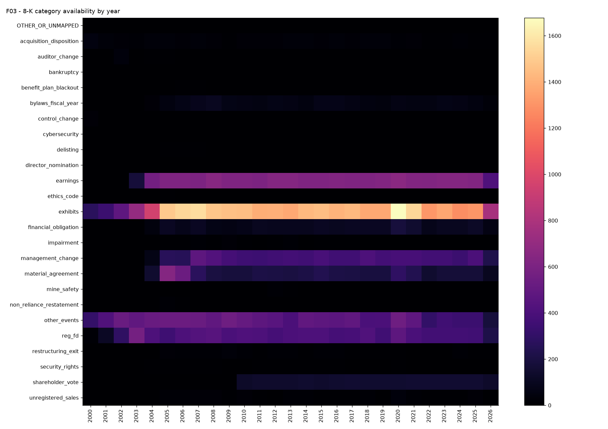

*F03 8-K category availability by year.* 8-K category availability by year under taxonomy v1 (legacy items before 2004-08-23).

### Timestamp quality
| year | A | B | C |
|---|---|---|---|
| 2000 | 0 | 650 | 233 |
| 2001 | 0 | 754 | 309 |
| 2002 | 882 | 258 | 229 |
| 2003 | 1,709 | 0 | 0 |
| 2004 | 2,095 | 0 | 0 |
| 2005 | 2,621 | 0 | 0 |
| 2006 | 2,626 | 0 | 0 |
| 2007 | 2,654 | 0 | 0 |
| 2008 | 2,562 | 0 | 0 |
| 2009 | 2,453 | 10 | 1 |
| 2010 | 2,517 | 0 | 0 |
| 2011 | 2,434 | 0 | 0 |
| 2012 | 2,448 | 0 | 0 |
| 2013 | 2,426 | 0 | 0 |
| 2014 | 2,475 | 0 | 0 |
| 2015 | 2,503 | 0 | 0 |
| 2016 | 2,467 | 0 | 0 |
| 2017 | 2,470 | 0 | 0 |
| 2018 | 2,420 | 0 | 0 |
| 2019 | 2,387 | 0 | 0 |
| 2020 | 2,683 | 0 | 0 |
| 2021 | 2,506 | 0 | 0 |
| 2022 | 2,266 | 0 | 0 |
| 2023 | 2,299 | 0 | 0 |
| 2024 | 2,236 | 0 | 0 |
| 2025 | 2,279 | 0 | 0 |
| 2026 | 1,399 | 0 | 0 |

Acceptance times: SGML header when the download carried one; otherwise the submissions-JSON value under the verified double-conversion rule (header disagreement rate 0.2975281199338158 over 59833 checks); pre-2002 filings have midnight placeholders (quality B, assumed 17:30 ET). Public availability is ASSUMED (acceptance + lag), not observed.

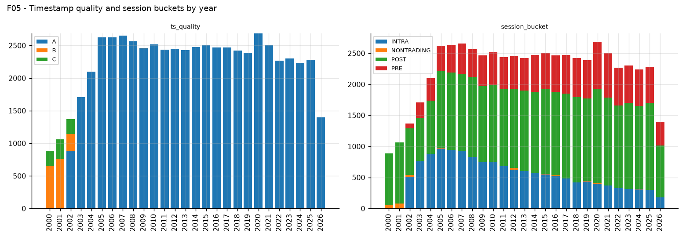

*F05 Timestamp quality and session buckets by year.* Timestamp quality (A exact / B date-only / C uncertain) and session buckets by year.

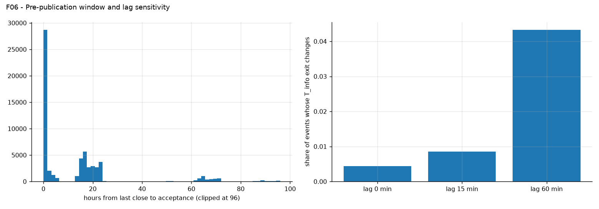

*F06 Pre-publication window and lag sensitivity.* Pre-publication window (last close -> acceptance) and the share of events whose clock changes under public-lag sensitivity.

### Hugging Face dataset audit
#### Hugging Face SEC dataset audit (S01)

- Repository: `JanosAudran/financial-reports-sec` at revision `5da7e3c8b920a586b8c36eecba4aaa0152a59a52` (raw JSONL shards, `large` config)
- Use: **audit, firm-overlap definition and 10-K section-parser QA only**. Its return labels and `returns` fields are never read (assertion in code). Filing text for the study comes from our own point-in-time EDGAR pipeline (SPEC.md §13.5).
- Firms (CIK): **4,677**; filings: **55,349**; forms present: {'10-K': 55349}
- Filing dates: 1994-01-06 to 2021-09-23
- Forms **not** present: 10-Q and 8-K (they come from EDGAR).
- Duplicate (cik, filing date, form) rows: 86; missing acceptance timestamps: 0; filings with zero sentences: 253
- Median sentences per filing: 1268; median non-empty sections: 20 of 20

### Limitations of the data
- SURVIVOR-ONLY universe: all firms are current listings (no delisted, merged or acquired firms), so the sample is survivorship-biased, not merely survivorship-aware; drift and backtest results overstate what a point-in-time universe would show. Daily bars only.
- Free prices are weak on delistings; local OHLCV is split-adjusted and dividends come from Yahoo actions.
- Selected sections only (10-K Items 1/1A/7/7A, 10-Q MD&A/market risk/risk factors, 8-K items + EX-99).
- SUE coverage is limited before the XBRL era (2009); release-EPS parsing is heuristic (QA vs XBRL reported).
- The HF corpus contains 10-Ks only (1994-2021); it defines the firm overlap and QA, never the study text.

## 2. Design
Four timestamps per event; T_trade (primary, prospective: entry at the first open at or after decision time, SPY on the identical interval) and T_info (information response; INTRA excluded); 3-class labels with k=0.5 x sigma x sqrt(h); per-horizon censoring at the usable cutoff; overlap flags (clean events = no same-firm event within 60 sessions).
| event_type | INTRA | NONTRADING | POST | PRE |
|---|---|---|---|---|
| 8K | 9,035 | 160 | 24,443 | 11,555 |
| periodic_10K | 1,205 | 34 | 2,224 | 334 |
| periodic_10Q | 4,133 | 78 | 6,022 | 1,038 |

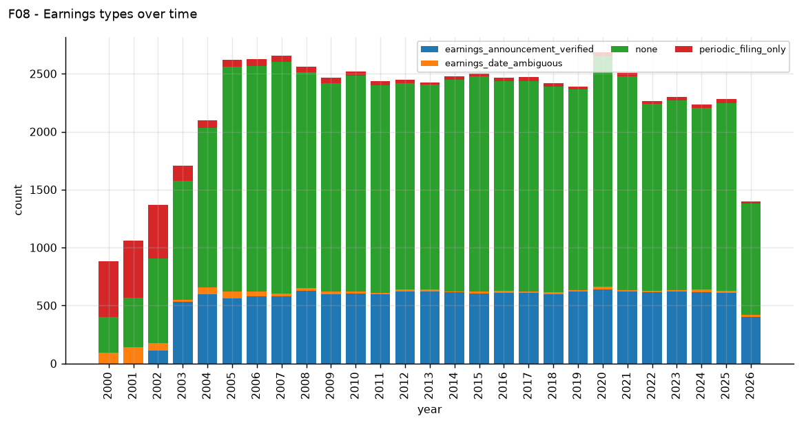

*F08 Earnings types over time.* Earnings event types over time (verified releases, periodic-only, ambiguous).

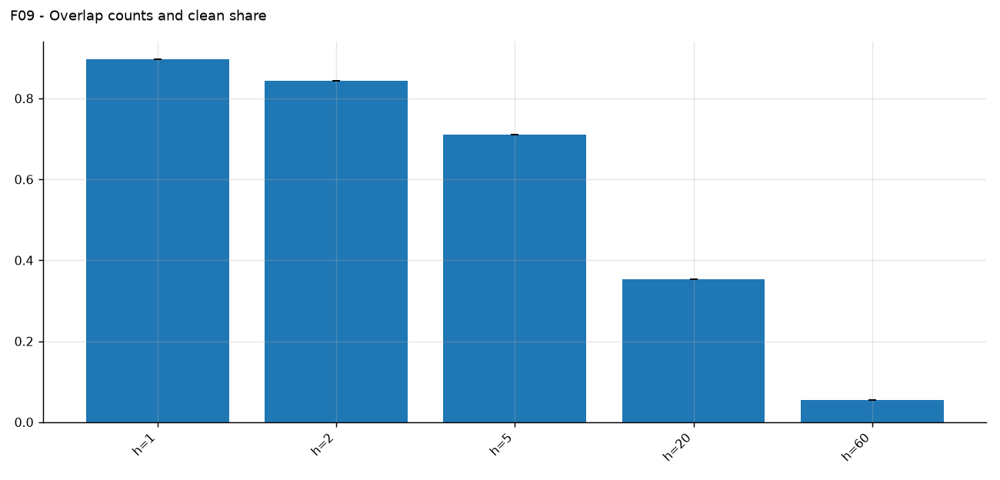

*F09 Overlap counts and clean share.* Same-firm overlap counts by horizon and the clean-event share.

## 3. Leakage and provenance audit
| item | check | status | detail |
|---|---|---|---|
| 1 | overlapping windows across blocks -> purge + embargo | pass | training events whose window reaches the next block: 0 |
| 2 | same-date shocks -> date-disjoint splits | pass | dates shared by train and val across folds: 0 |
| 3 | duplicate / near-duplicate filings -> split by accession; hashes | pass | accessions in >1 event: 0; identical-text events across blocks: n/a |
| 4 | firm memorization -> anonymization; firm-held-out test | built, not scored | masked firm-name hits: 881908; stress_firm folds: 5; firm- and sector-held-out fold scores were not produced in this run (report-level relabel) |
| 5 | preprocessing fitted on training indices only (scalers, TF-IDF, PCA, imputers, calibration, thresholds, clip bounds) | pass (code-enforced; unit test) | fold pipelines fit on train rows only |
| 6 | test peeking -> prereg hash; G4 freeze; lockbox | info | checked at S18/S19 (lockbox log) |
| 7 | intraday / pre-publication contamination -> T_info eligibility | pass | INTRA events eligible for T_info: 0; median pre-publication window (min): 166 |
| 8 | timestamp errors -> four timestamps; quality flags; sensitivity | pass | ts_quality counts {'A': 57817, 'B': 1672, 'C': 772}; JSON-rule header mismatch rate 0.2975281199338158 |
| 9 | EAR misuse -> registry rule + planted leak | pass | violations: 0 |
| 10 | earnings-date fabrication -> three earnings types | pass | {'earnings_announcement_verified': 14407, 'periodic_filing_only': 2381, 'earnings_date_ambiguous': 816} |
| 11 | SUE from a later cluster accession -> registry rule + planted leak | pass | violations: 0 |
| 12 | XBRL ordering -> accession / public_available_time ordering | pass | quarterly EPS = earliest public accession per period (as first reported) |
| 13 | same-firm overlaps -> flags + clean cohort | pass | clean events: 3346 of 60261 |
| 14 | survivorship -> universe table + wording | info | delisted firms in universe: 0; SURVIVOR-ONLY universe (current listings only, survivorship-biased): stated in the report, reported with the share of historical S&P 500 members our data covers |
| 15 | right-censoring -> per horizon | pass | censored target rows dropped: 2702 |
| 16 | retrieval leakage -> historical index time filter; separate current path | pass | guard unit check on planted future document |
| 17 | analogue outcomes (extension) | na | ext_analogue disabled |
| 18 | pretrained-model look-ahead -> provenance rules | pass | per-fold strict/retrospective labels written |
| 19 | distillation / continued pretraining -> training-period data only | info | asserted at S17 |
| 20 | stacking -> walk-forward out-of-fold predictions only | info | asserted in ext_stacking |
| 21 | outcome-based selection -> event construction reads no price fields | pass | price fields in events: [] |
| 22 | data snooping -> configuration counter; FDR; MCS / PBO diagnostics | info | configuration counter in results_long; FDR families in preregistration |
| 23 | covariate shift -> adversarial validation (AUC near 0.5 does not prove a split unbiased) | info | computed in S11 (F39) |
| 24 | broken audit -> planted-leak self-tests (4) | pass | future_return_feature: caught; same_event_EAR: caught; later_cluster_SUE: caught; future_document_retrieval: caught |

### Model provenance ledger
| key | model_id | revision | license | stated_cutoff |
|---|---|---|---|---|
| sec_bert | nlpaueb/sec-bert-base | d511591f5e74052afdab08f1f14c4ff2a1e55749 | cc-by-sa-4.0 | 2019-12-31 |
| finbert_tone | yiyanghkust/finbert-tone | 4921590d3c0c3832c0efea24c8381ce0bda7844b | not stated on card | unknown |
| chrono_bert | manelalab/chrono-bert-v1-{year}1231 | per-vintage (see models.yaml) | mit | vintage |
| bge_base | BAAI/bge-base-en-v1.5 | a5beb1e3e68b9ab74eb54cfd186867f64f240e1a | mit | unknown |
| bge_reranker | BAAI/bge-reranker-base | 2cfc18c9415c912f9d8155881c133215df768a70 | mit | unknown |
| qwen | Qwen/Qwen2.5-7B-Instruct | a09a35458c702b33eeacc393d103063234e8bc28 | apache-2.0 | unknown |
| nli_judge | cross-encoder/nli-deberta-v3-base | 6c749ce3425cd33b46d187e45b92bbf96ee12ec7 | apache-2.0 | unknown |
| modernbert_base | answerdotai/ModernBERT-base | 8949b909ec900327062f0ebf497f51aef5e6f0c8 | apache-2.0 | unknown |
| bert_ner | dslim/bert-base-NER | d1a3e8f13f8c3566299d95fcfc9a8d2382a9affc | mit | unknown |
| lightgbm | lightgbm | library version in environment manifest | n/a | trained on our folds only |
| catboost | catboost | library version in environment manifest | n/a | trained on our folds only |
| enet | enet | library version in environment manifest | n/a | trained on our folds only |

### Sanity experiments and review triggers
| check | observed | null_mean | p_value | n_perm | note |
|---|---|---|---|---|---|
| permutation test (within-month, class-stratified) | 0.389 | 0.251 | 0.000 | 10 | n/a |
| random-split demo (pedagogical) | 0.403 | 0.389 | n/a | n/a | n/a |
| adversarial validation AUC, firm-level features (mean over folds) | 1.000 | 0.500 | n/a | n/a | AUC near 1: training and validation periods are separable (covariate shift); this is not by itself evidence of leakage, which the audit above tests directly; main drivers (last fold): acc_roa, tfidf_svd3, tfidf_svd5, tfidf_svd4 |
| adversarial validation AUC, all features incl. market-wide / calendar (mean) | 1.000 | 0.500 | n/a | n/a | date-level features fingerprint each date, so this AUC is ~1 by construction |
| review triggers | 0 | n/a | n/a | n/a | n/a |

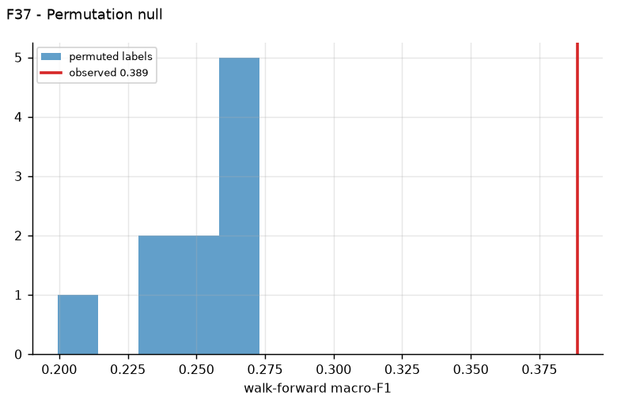

*F37 Permutation null.* Permutation null: distribution of macro-F1 under within-block class-stratified label permutation vs the observed value.

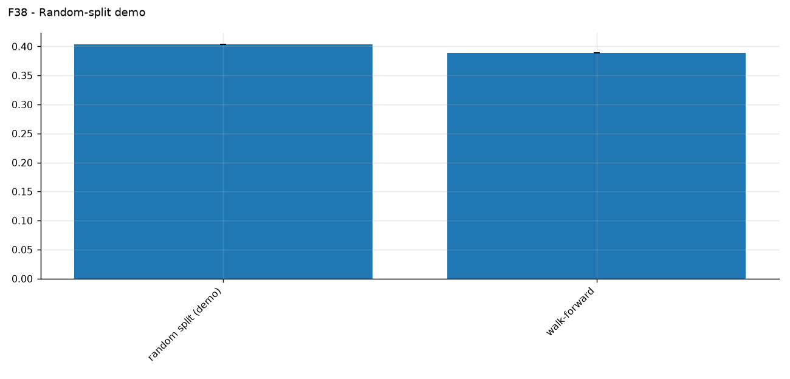

*F38 Random-split demo.* Random-split demo (pedagogical only): random split vs walk-forward macro-F1.

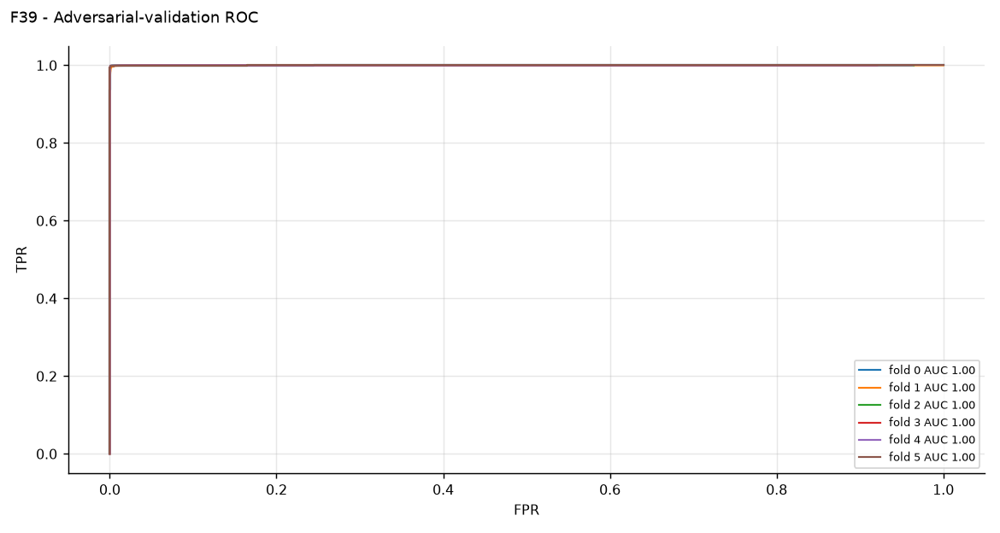

*F39 Adversarial-validation ROC.* Adversarial validation ROC per fold (an AUC near 0.5 does not prove a split is unbiased).

**Reading MCS and PBO here.** The Model Confidence Set on development log-loss keeps ['L6_nochange', 'L7', 'STACK']; the Probability of Backtest Overfitting is 0.0 over 93 stored configurations. PBO = 0 mainly reflects that the stored configurations mix rungs with very different information content (L0 to L7), so the best in-sample configuration is trivially the best out-of-sample one; it does not test overfitting of the close call between L6 and L7. Both are diagnostics only.

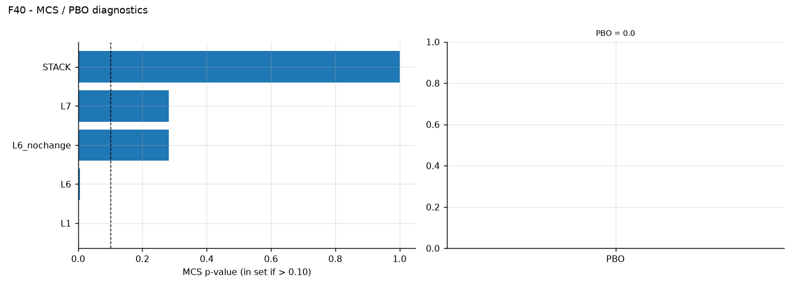

*F40 MCS / PBO diagnostics.* Selection diagnostics: Model Confidence Set membership and PBO (diagnostics only).

## 4. Track A: event study (association only)
| group | event_set | measure | mean | t | p_adj_bh | n |
|---|---|---|---|---|---|---|
| 8K | all | car_m1_1 | 0.001 | 3.179 | 0.011 | 44,798 |
| 8K | all | car_0_1 | 0.001 | 2.726 | 0.032 | 44,798 |
| 8K | all | car_2_60 | -0.001 | -1.180 | 0.446 | 44,368 |
| 8K | all | car4_m1_1 | 0.001 | 3.541 | 0.005 | 44,798 |
| 8K | all | car4_2_60 | -0.002 | -2.340 | 0.077 | 44,368 |
| 8K | clean | car_m1_1 | 0.006 | 3.703 | 0.003 | 1,901 |
| 8K | clean | car_0_1 | 0.006 | 3.377 | 0.007 | 1,901 |
| 8K | clean | car_2_60 | -0.009 | -3.119 | 0.013 | 1,777 |
| 8K | clean | car4_m1_1 | 0.007 | 3.883 | 0.002 | 1,901 |
| 8K | clean | car4_2_60 | -0.011 | -3.651 | 0.003 | 1,777 |
| periodic_10K | all | car_m1_1 | 0.001 | 1.126 | 0.454 | 3,756 |
| periodic_10K | all | car_0_1 | 0.001 | 1.516 | 0.324 | 3,756 |
| periodic_10K | all | car_2_60 | 0.006 | 2.125 | 0.114 | 3,741 |
| periodic_10K | all | car4_m1_1 | 0.001 | 1.211 | 0.442 | 3,756 |
| periodic_10K | all | car4_2_60 | 0.007 | 2.386 | 0.070 | 3,741 |
| periodic_10K | clean | car_m1_1 | 0.014 | 0.887 | 0.546 | 20 |
| periodic_10K | clean | car_0_1 | 0.007 | 0.584 | 0.678 | 20 |
| periodic_10K | clean | car_2_60 | -0.044 | -1.294 | 0.416 | 14 |
| periodic_10K | clean | car4_m1_1 | 0.011 | 0.636 | 0.653 | 20 |
| periodic_10K | clean | car4_2_60 | -0.011 | -0.407 | 0.778 | 14 |
| periodic_10Q | all | car_m1_1 | 0.000 | 0.098 | 0.945 | 11,126 |
| periodic_10Q | all | car_0_1 | -0.001 | -1.330 | 0.403 | 11,126 |
| periodic_10Q | all | car_2_60 | -0.003 | -2.749 | 0.031 | 11,013 |
| periodic_10Q | all | car4_m1_1 | 0.000 | 0.656 | 0.651 | 11,126 |
| periodic_10Q | all | car4_2_60 | -0.004 | -3.223 | 0.010 | 11,013 |
| periodic_10Q | clean | car_m1_1 | 0.002 | 1.088 | 0.471 | 1,342 |
| periodic_10Q | clean | car_0_1 | 0.002 | 1.191 | 0.446 | 1,342 |
| periodic_10Q | clean | car_2_60 | -0.002 | -0.525 | 0.714 | 1,286 |
| periodic_10Q | clean | car4_m1_1 | 0.002 | 0.884 | 0.546 | 1,342 |
| periodic_10Q | clean | car4_2_60 | -0.002 | -0.535 | 0.709 | 1,286 |

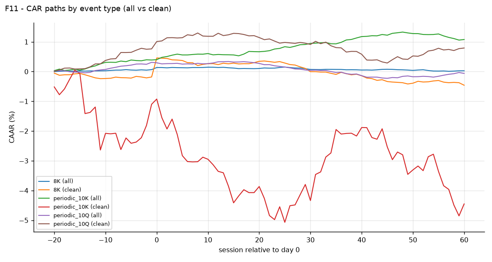

*F11 CAR paths by event type (all vs clean).* Average cumulative abnormal return path (market model) around day 0 by event type, all events vs clean events.

![F12 CAR[0,+1] by session bucket](figures/F12.png)

*F12 CAR[0,+1] by session bucket.* CAR[0,+1] by session bucket (INTRA day 0 is a mixed pre/post interval).

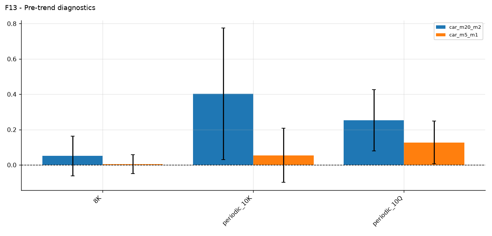

*F13 Pre-trend diagnostics.* Pre-trend diagnostics: CAR[-20,-2] and CAR[-5,-1] by event type (interpreted, not forced to zero).

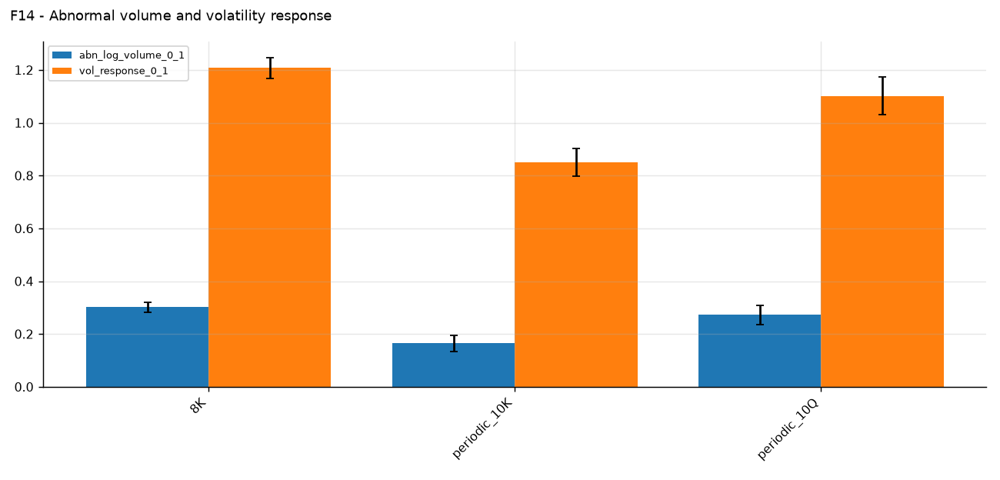

*F14 Abnormal volume and volatility response.* Abnormal log volume and volatility response on days [0,+1] by event type.

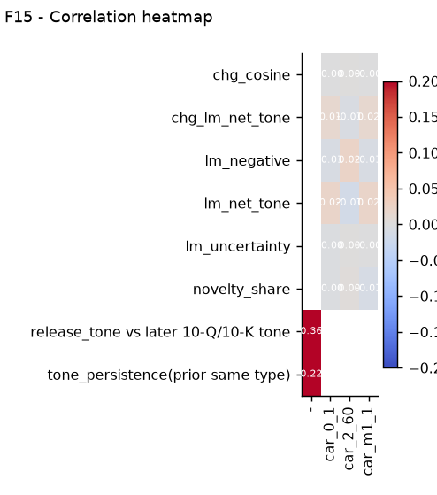

*F15 Correlation heatmap.* Spearman correlations between text features and event-window CARs (association only).

### Drift tests and verdicts
| test | estimate | ci_low | ci_high | p_value | p_adj_bh | n | verdict |
|---|---|---|---|---|---|---|---|
| SUE-conditioned post-earnings drift (Q5-Q1, SUE_release) | -0.026 | -0.035 | -0.017 | 0.000 | 0.000 | 3,825 | supported |
| drift sorted on SUE_xbrl (EX-POST sensitivity, not tradable) | -0.024 | -0.033 | -0.013 | 0.000 | 0.000 | 3,486 | weak/mixed |
| drift sorted on EAR (observed before +2) | 0.008 | -0.002 | 0.017 | 0.086 | 0.119 | 5,693 | not supported |
| SUE-conditioned post-earnings drift (Q5-Q1) [S&P 500 members] | -0.026 | -0.035 | -0.017 | 0.000 | 0.000 | 3,825 | weak/mixed |
| SUE-conditioned post-earnings drift (Q5-Q1) [non-S&P 500 firms] | n/a | n/a | n/a | n/a | n/a | 0 | inconclusive/low power |
| momentum benchmark: mom_12_1 (monthly decile long-short) | 0.005 | n/a | n/a | 0.445 | 0.445 | 305 | benchmark (not a filing effect) |
| momentum benchmark: mom_12_2 (monthly decile long-short) | 0.007 | n/a | n/a | 0.222 | 0.364 | 305 | benchmark (not a filing effect) |
| momentum benchmark: rev_1m (monthly decile long-short) | 0.004 | n/a | n/a | 0.242 | 0.364 | 305 | benchmark (not a filing effect) |
| text beyond momentum: lm_net_tone -> CAR[+2,+60] | -0.002 | n/a | n/a | 0.002 | 0.005 | 53,892 | weak/mixed |
| text beyond momentum: chg_cosine -> CAR[+2,+60] | 0.001 | n/a | n/a | 0.378 | 0.394 | 53,892 | not supported |
| text beyond momentum: novelty_share -> CAR[+2,+60] | 0.002 | n/a | n/a | 0.030 | 0.050 | 53,892 | weak/mixed |
| post-dividend-announcement drift: increase | -0.003 | n/a | n/a | 0.394 | 0.394 | 1,189 | not supported |
| post-dividend-announcement drift: decrease | 0.054 | n/a | n/a | 0.032 | 0.050 | 223 | weak/mixed |
| post-dividend-announcement drift: initiation | n/a | n/a | n/a | n/a | n/a | 68 | inconclusive/low power |
| restructuring / spin-off drift: 8-K restructuring_exit | 0.031 | n/a | n/a | 0.000 | 0.001 | 303 | weak/mixed |
| restructuring / spin-off drift: 8-K impairment | 0.014 | n/a | n/a | 0.343 | 0.394 | 166 | not supported |
| restructuring / spin-off drift: 8-K acquisition_disposition | -0.025 | n/a | n/a | 0.005 | 0.010 | 591 | weak/mixed |
| analyst revisions drift | n/a | n/a | n/a | n/a | n/a | n/a | not testable in scope |
| insider trading drift | n/a | n/a | n/a | n/a | n/a | n/a | not testable in scope |
| institutional ownership drift | n/a | n/a | n/a | n/a | n/a | n/a | not testable in scope |
SUE-conditioned drift (Q5-Q1, CAR[+2,+60]) = -2.63% [-3.50%, -1.70%], n=3,825, verdict **supported**: a REVERSAL (high-SUE firms underperform low-SUE firms after the announcement), the opposite of classic post-earnings drift. The verdict rubric tests strength and robustness, not direction. The universe is survivor-only: firms that delisted after bad news are absent, which pushes low-SUE drift upwards; these data cannot separate that bias from a genuine reversal. Never a consensus-based PEAD replication (decision log D-073).

![F16 SUE-drift quintile CAR[+2,+60]](figures/F16.png)

*F16 SUE-drift quintile CAR[+2,+60].* SUE-conditioned post-earnings drift: CAR[+2,+60] by SUE_release quintile (prior-quarter breakpoints).

## 5. Track B: prediction
Primary target: T_trade h=1 3-class; primary metric: mean walk-forward macro-F1 (guardrails: log-loss no worse than the class prior; ECE). Results are validation-selected. Strict leaderboard = models whose documented cutoff precedes every evaluated event (ChronoBERT vintages, models trained on our folds, lexical baselines; SEC-BERT only after 2019); retrospective = all models.

### Ladder (walk-forward, primary target)
| rung | model_id | encoder | cohort | tuned | leaderboard | mean_fold_score | pooled_macro_f1 | ci_low | ci_high | n_events |
|---|---|---|---|---|---|---|---|---|---|---|
| L2 | enet | n/a | bucket_SP500 | tuned_transferred | strict | 0.331 | 0.358 | 0.347 | 0.368 | 28,533 |
| L6 | enet | n/a | bucket_SP500 | tuned_transferred | strict | 0.389 | 0.392 | 0.385 | 0.398 | 28,533 |
| L0 | prior | n/a | common | default | strict | 0.191 | 0.191 | 0.186 | 0.195 | 28,533 |
| L1 | lightgbm | n/a | common | default | strict | 0.352 | 0.354 | 0.345 | 0.362 | 28,533 |
| L1 | lightgbm | n/a | common | tuned | strict | 0.358 | 0.362 | 0.354 | 0.370 | 28,533 |
| L1 | catboost | n/a | common | default | strict | 0.352 | 0.358 | 0.350 | 0.366 | 28,533 |
| L1 | catboost | n/a | common | tuned | strict | 0.318 | 0.337 | 0.325 | 0.348 | 28,533 |
| L1 | enet | n/a | common | default | strict | 0.350 | 0.360 | 0.350 | 0.369 | 28,533 |
| L1 | enet | n/a | common | tuned | strict | 0.345 | 0.360 | 0.352 | 0.368 | 28,533 |
| L2 | lightgbm | n/a | common | default | strict | 0.360 | 0.374 | 0.365 | 0.381 | 28,533 |
| L2 | lightgbm | n/a | common | tuned | strict | 0.371 | 0.379 | 0.371 | 0.386 | 28,533 |
| L2 | catboost | n/a | common | default | strict | 0.353 | 0.365 | 0.357 | 0.373 | 28,533 |
| L2 | catboost | n/a | common | tuned | strict | 0.350 | 0.367 | 0.358 | 0.375 | 28,533 |
| L2 | enet | n/a | common | default | strict | 0.331 | 0.358 | 0.347 | 0.368 | 28,533 |
| L2 | enet | n/a | common | tuned | strict | 0.331 | 0.358 | 0.347 | 0.368 | 28,533 |
| L3 | lightgbm | n/a | common | default | strict | 0.319 | 0.340 | 0.329 | 0.350 | 28,533 |
| L3 | lightgbm | n/a | common | tuned | strict | 0.323 | 0.347 | 0.337 | 0.357 | 28,533 |
| L3 | catboost | n/a | common | default | strict | 0.312 | 0.348 | 0.336 | 0.358 | 28,533 |
| L3 | catboost | n/a | common | tuned | strict | 0.312 | 0.348 | 0.336 | 0.358 | 28,533 |
| L3 | enet | n/a | common | default | strict | 0.237 | 0.284 | 0.267 | 0.299 | 28,533 |
| L3 | enet | n/a | common | tuned | strict | 0.238 | 0.345 | 0.331 | 0.357 | 28,533 |
| L4 | lightgbm | n/a | common | default | strict | 0.361 | 0.371 | 0.364 | 0.378 | 28,533 |
| L4 | lightgbm | n/a | common | tuned | strict | 0.365 | 0.374 | 0.367 | 0.381 | 28,533 |
| L4 | catboost | n/a | common | default | strict | 0.357 | 0.368 | 0.361 | 0.374 | 28,533 |
| L4 | catboost | n/a | common | tuned | strict | 0.359 | 0.372 | 0.365 | 0.379 | 28,533 |
| L4 | enet | n/a | common | default | strict | 0.352 | 0.364 | 0.355 | 0.371 | 28,533 |
| L4 | enet | n/a | common | tuned | strict | 0.352 | 0.364 | 0.355 | 0.371 | 28,533 |
| L4_change | lightgbm | n/a | common | default | strict | 0.333 | 0.353 | 0.346 | 0.360 | 28,533 |
| L4_change | lightgbm | n/a | common | tuned | strict | 0.338 | 0.357 | 0.349 | 0.364 | 28,533 |
| L4_change | catboost | n/a | common | default | strict | 0.337 | 0.356 | 0.349 | 0.363 | 28,533 |
| L4_change | catboost | n/a | common | tuned | strict | 0.334 | 0.353 | 0.345 | 0.360 | 28,533 |
| L4_change | enet | n/a | common | default | strict | 0.331 | 0.349 | 0.342 | 0.357 | 28,533 |
| L4_change | enet | n/a | common | tuned | strict | 0.331 | 0.349 | 0.342 | 0.357 | 28,533 |
| L4_levels | lightgbm | n/a | common | default | strict | 0.360 | 0.371 | 0.364 | 0.378 | 28,533 |
| L4_levels | lightgbm | n/a | common | tuned | strict | 0.359 | 0.373 | 0.365 | 0.379 | 28,533 |
| L4_levels | catboost | n/a | common | default | strict | 0.357 | 0.371 | 0.364 | 0.379 | 28,533 |
| L4_levels | catboost | n/a | common | tuned | strict | 0.351 | 0.369 | 0.361 | 0.376 | 28,533 |
| L4_levels | enet | n/a | common | default | strict | 0.352 | 0.363 | 0.355 | 0.370 | 28,533 |
| L4_levels | enet | n/a | common | tuned | strict | 0.352 | 0.363 | 0.355 | 0.370 | 28,533 |
| L6 | lightgbm | n/a | common | default | strict | 0.388 | 0.391 | 0.385 | 0.397 | 28,533 |
| L6 | lightgbm | n/a | common | tuned | strict | 0.387 | 0.390 | 0.383 | 0.397 | 28,533 |
| L6 | catboost | n/a | common | default | strict | 0.381 | 0.386 | 0.379 | 0.392 | 28,533 |
| L6 | catboost | n/a | common | tuned | strict | 0.378 | 0.385 | 0.378 | 0.393 | 28,533 |
| L6 | enet | n/a | common | default | strict | 0.322 | 0.342 | 0.327 | 0.354 | 28,533 |
| L6 | enet | n/a | common | tuned | strict | 0.389 | 0.392 | 0.385 | 0.398 | 28,533 |
| L6_nochange | lightgbm | n/a | common | default | strict | 0.387 | 0.390 | 0.383 | 0.396 | 28,533 |
| L6_nochange | lightgbm | n/a | common | tuned | strict | 0.384 | 0.388 | 0.381 | 0.395 | 28,533 |
| L6_nochange | catboost | n/a | common | default | strict | 0.381 | 0.386 | 0.378 | 0.393 | 28,533 |
| L6_nochange | catboost | n/a | common | tuned | strict | 0.382 | 0.388 | 0.381 | 0.395 | 28,533 |
| L6_nochange | enet | n/a | common | default | strict | 0.326 | 0.347 | 0.332 | 0.359 | 28,533 |
| L6_nochange | enet | n/a | common | tuned | strict | 0.388 | 0.393 | 0.386 | 0.399 | 28,533 |
| L5 | lightgbm | chrono_bert | common_emb | default | strict | 0.341 | 0.361 | 0.353 | 0.369 | 28,533 |
| L5 | lightgbm | chrono_bert | common_emb | tuned | strict | 0.341 | 0.361 | 0.353 | 0.370 | 28,533 |
| L5 | enet | chrono_bert | common_emb | default | strict | 0.334 | 0.363 | 0.354 | 0.372 | 28,533 |
| L5 | enet | chrono_bert | common_emb | tuned | strict | 0.333 | 0.363 | 0.354 | 0.372 | 28,533 |
| L5 | lightgbm | bge_base | common_emb | default | retrospective | 0.351 | 0.368 | 0.360 | 0.375 | 28,533 |
| L5 | lightgbm | bge_base | common_emb | tuned | retrospective | 0.352 | 0.367 | 0.358 | 0.374 | 28,533 |
| L5 | enet | bge_base | common_emb | default | retrospective | 0.351 | 0.357 | 0.350 | 0.364 | 28,533 |
| L5 | enet | bge_base | common_emb | tuned | retrospective | 0.351 | 0.357 | 0.350 | 0.364 | 28,533 |
| L6 | lightgbm | n/a | common_emb | tuned | strict | 0.391 | 0.394 | 0.388 | 0.401 | 28,533 |

_33 more rows in the CSV._

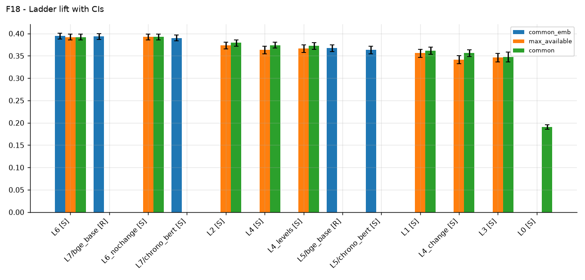

*F18 Ladder lift with CIs.* Ablation ladder: walk-forward macro-F1 by rung with month-block bootstrap CIs (common and maximum-available cohorts).

### Pre-registered guardrails (log-loss no worse than the class prior; ECE <= 0.10; 1 = met)
| rung | model_id | revision | tuned | ece | guardrail_ece_ok | guardrail_logloss_ok | logloss | logloss_prior |
|---|---|---|---|---|---|---|---|---|
| L0 | prior | n/a | default | 0.026 | 1.000 | 0.000 | 1.090 | 1.089 |
| L1 | catboost | n/a | default | 0.016 | 1.000 | 1.000 | 1.083 | 1.089 |
| L1 | catboost | n/a | tuned | 0.012 | 1.000 | 1.000 | 1.085 | 1.089 |
| L1 | enet | n/a | default | 0.011 | 1.000 | 1.000 | 1.081 | 1.089 |
| L1 | enet | n/a | tuned | 0.018 | 1.000 | 1.000 | 1.083 | 1.089 |
| L1 | lightgbm | n/a | default | 0.010 | 1.000 | 1.000 | 1.084 | 1.089 |
| L1 | lightgbm | n/a | tuned | 0.013 | 1.000 | 1.000 | 1.082 | 1.089 |
| L2 | catboost | n/a | default | 0.005 | 1.000 | 1.000 | 1.071 | 1.089 |
| L2 | catboost | n/a | tuned | 0.012 | 1.000 | 1.000 | 1.072 | 1.089 |
| L2 | enet | n/a | default | 0.008 | 1.000 | 1.000 | 1.077 | 1.089 |
| L2 | enet | n/a | tuned | 0.008 | 1.000 | 1.000 | 1.077 | 1.089 |
| L2 | lightgbm | n/a | default | 0.009 | 1.000 | 1.000 | 1.073 | 1.089 |
| L2 | lightgbm | n/a | tuned | 0.008 | 1.000 | 1.000 | 1.070 | 1.089 |
| L3 | catboost | n/a | default | 0.021 | 1.000 | 1.000 | 1.085 | 1.089 |
| L3 | catboost | n/a | tuned | 0.021 | 1.000 | 1.000 | 1.085 | 1.089 |
| L3 | enet | n/a | default | 0.025 | 1.000 | 0.000 | 1.097 | 1.089 |
| L3 | enet | n/a | tuned | 0.015 | 1.000 | 1.000 | 1.087 | 1.089 |
| L3 | lightgbm | n/a | default | 0.008 | 1.000 | 1.000 | 1.087 | 1.089 |
| L3 | lightgbm | n/a | tuned | 0.015 | 1.000 | 1.000 | 1.086 | 1.089 |
| L4 | catboost | n/a | default | 0.013 | 1.000 | 1.000 | 1.074 | 1.089 |
| L4 | catboost | n/a | tuned | 0.015 | 1.000 | 1.000 | 1.076 | 1.089 |
| L4 | enet | n/a | default | 0.020 | 1.000 | 1.000 | 1.075 | 1.089 |
| L4 | enet | n/a | tuned | 0.020 | 1.000 | 1.000 | 1.075 | 1.089 |
| L4 | lightgbm | n/a | default | 0.017 | 1.000 | 1.000 | 1.075 | 1.089 |
| L4 | lightgbm | n/a | tuned | 0.015 | 1.000 | 1.000 | 1.074 | 1.089 |
| L4_change | catboost | n/a | default | 0.007 | 1.000 | 1.000 | 1.081 | 1.089 |
| L4_change | catboost | n/a | tuned | 0.006 | 1.000 | 1.000 | 1.082 | 1.089 |
| L4_change | enet | n/a | default | 0.011 | 1.000 | 1.000 | 1.083 | 1.089 |
| L4_change | enet | n/a | tuned | 0.011 | 1.000 | 1.000 | 1.083 | 1.089 |
| L4_change | lightgbm | n/a | default | 0.009 | 1.000 | 1.000 | 1.082 | 1.089 |
| L4_change | lightgbm | n/a | tuned | 0.005 | 1.000 | 1.000 | 1.081 | 1.089 |
| L4_levels | catboost | n/a | default | 0.015 | 1.000 | 1.000 | 1.075 | 1.089 |
| L4_levels | catboost | n/a | tuned | 0.014 | 1.000 | 1.000 | 1.077 | 1.089 |
| L4_levels | enet | n/a | default | 0.022 | 1.000 | 1.000 | 1.076 | 1.089 |
| L4_levels | enet | n/a | tuned | 0.022 | 1.000 | 1.000 | 1.076 | 1.089 |
| L4_levels | lightgbm | n/a | default | 0.013 | 1.000 | 1.000 | 1.075 | 1.089 |
| L4_levels | lightgbm | n/a | tuned | 0.016 | 1.000 | 1.000 | 1.075 | 1.089 |
| L6 | catboost | n/a | default | 0.010 | 1.000 | 1.000 | 1.067 | 1.089 |
| L6 | catboost | n/a | tuned | 0.007 | 1.000 | 1.000 | 1.071 | 1.089 |
| L6 | enet | n/a | default | 0.035 | 1.000 | 1.000 | 1.081 | 1.089 |

_9 more rows in the CSV._

### Hypotheses H1-H4 (with CIs)
| hypothesis | value | ci_low | ci_high | p_boot | n | G3 |
|---|---|---|---|---|---|---|
| H1 (walk-forward): best L7 - L6 | -0.001 | -0.007 | 0.005 | 0.740 | 28,533 | 0 |
| H1 (development holdout): L7 - L6 | 0.007 | -0.001 | 0.016 | 0.100 | 7,453 | n/a |
| H2 (development holdout): L6 - L6_nochange | 0.002 | -0.003 | 0.006 | 0.426 | 7,453 | n/a |
| H5 (development holdout): STACK - L7 | -0.003 | -0.012 | 0.008 | 0.556 | 7,453 | n/a |
| H4 L5/lightgbm: ChronoBERT vintage - bge_base | -0.005 | -0.012 | 0.002 | 0.136 | 28,533 | n/a |
| H4 L5/enet: ChronoBERT vintage - bge_base | 0.006 | -0.002 | 0.014 | 0.140 | 28,533 | n/a |
| H4 L7/lightgbm: ChronoBERT vintage - bge_base | -0.004 | -0.009 | 0.002 | 0.146 | 28,533 | n/a |
| H4 L7/enet: ChronoBERT vintage - bge_base | 0.002 | -0.007 | 0.011 | 0.614 | 28,533 | n/a |

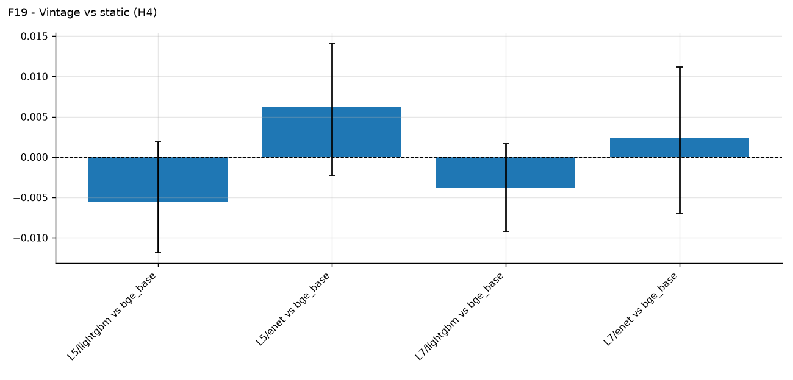

*F19 Vintage vs static (H4).* H4: point-in-time ChronoBERT vintages vs static encoders on identical rows and heads.

### 5a. How good is the accuracy, really? Chance level, move versus direction, locked-test lifts
**Chance level.** The report's majority-class baseline (macro-F1 0.191) and the permutation null (0.251) are both below the macro-F1 that any classifier with balanced predictions gets by luck: shuffling a model's own predicted classes against the true labels gives about 0.328 for the L6 and L7 models. Read model scores against that line, not against the majority-class baseline.

**Move versus direction.** On the locked test L6 scores macro-F1 0.384, +0.057 above its chance level. Almost all of that comes from telling moving stocks from quiet ones (move AUC 0.635 [0.623, 0.649]); among stocks that did move, the probabilities carry **no detectable directional information** (the CI includes 0.5) (direction AUC 0.494 [0.475, 0.509]). The models predict how much a stock will react, which is largely a volatility and event-type effect, not which way it will go.

Locked-test class shares: Down 0.326, Sideways 0.366, Up 0.307; always predicting Sideways would be right 0.366 of the time.

The structured-feature gain over price-only varies strongly by period because the price-only baseline L1 does: its macro-F1 is 0.360 (walk-forward 2008-2019), 0.305 (development 2020-2022), 0.351 (locked 2023-2026). L6 is stable (see table).

| period | model | n | macro-F1 | chance (shuffled) | move AUC | direction AUC |
|---|---|---|---|---|---|---|
| walk-forward 2008-2019 | L1 | 28,533 | 0.360 | 0.328 | 0.568 [0.556, 0.579] | 0.511 [0.503, 0.521] |
| walk-forward 2008-2019 | L6 | 28,533 | 0.392 | 0.329 | 0.629 [0.619, 0.640] | 0.512 [0.502, 0.522] |
| walk-forward 2008-2019 | L7 | 28,533 | 0.393 | 0.331 | 0.625 [0.615, 0.634] | 0.516 [0.506, 0.526] |
| development 2020-2022 | L1 | 7,453 | 0.305 | 0.265 | 0.600 [0.576, 0.627] | 0.514 [0.499, 0.531] |
| development 2020-2022 | L6 | 7,453 | 0.396 | 0.327 | 0.651 [0.634, 0.667] | 0.495 [0.478, 0.510] |
| development 2020-2022 | L7 | 7,453 | 0.404 | 0.329 | 0.647 [0.630, 0.664] | 0.506 [0.487, 0.520] |
| locked 2023-2026 | L1 | 8,199 | 0.351 | 0.329 | 0.538 [0.521, 0.552] | 0.500 [0.479, 0.517] |
| locked 2023-2026 | L6 | 8,199 | 0.384 | 0.327 | 0.635 [0.623, 0.649] | 0.494 [0.475, 0.509] |
| locked 2023-2026 | L7 | 8,199 | 0.383 | 0.327 | 0.637 [0.625, 0.651] | 0.494 [0.477, 0.512] |

**Paired lifts by period** (macro-F1 difference on identical events, 95% month-block bootstrap CI). The pipeline itself computes H1 on the walk-forward folds (gate G3) and H1, H2 and H5 on the development holdout; every other cell, including the whole locked-test column, is computed here from the stored predictions with the same bootstrap.

| comparison | walk-forward 2008-2019 | development 2020-2022 | locked 2023-2026 |
|---|---|---|---|
| L7 - L6 | -0.001 [-0.007, 0.005] p=0.74 | +0.007 [-0.001, 0.016] p=0.10 | -0.001 [-0.012, 0.009] p=0.80 |
| L6 - L6_nochange | -0.001 [-0.003, 0.002] p=0.70 | +0.002 [-0.003, 0.006] p=0.43 | -0.002 [-0.007, 0.003] p=0.54 |
| L6 - L1 | +0.032 [0.023, 0.041] p=0.00 | +0.091 [0.070, 0.115] p=0.00 | +0.033 [0.022, 0.045] p=0.00 |

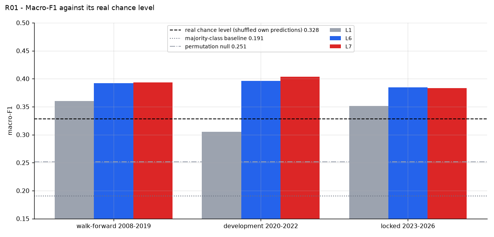

*R01 Macro-F1 against its real chance level.* Macro-F1 of L1, L6 and L7 in each period against the real chance level (shuffled own predictions), the majority-class baseline and the permutation null.

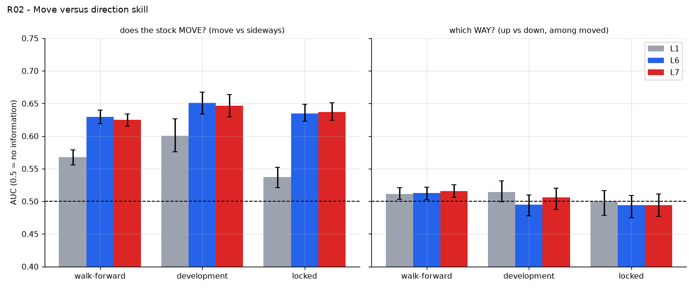

*R02 Move versus direction skill.* Two AUCs per model and period: does the stock move (move vs sideways) and which way (up vs down among moved events). 0.5 = no information; bars are month-block bootstrap 95% CIs.

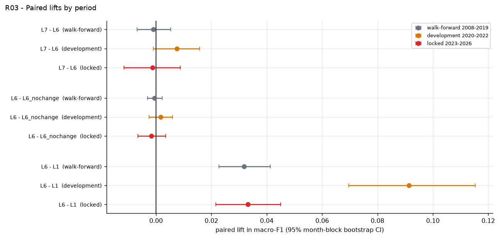

*R03 Paired lifts by period.* Paired macro-F1 lifts on identical events in each period (text over structured, change features, structured over price-only) with 95% month-block bootstrap CIs.

**Which model is 'best'?** The pre-registered rule freezes the model with the highest walk-forward mean macro-F1. That is **L7** (lightgbm/bge_base, retrospective leaderboard) with 0.3898, against 0.3888 for the best strict model L6 as scored in S11, a margin of +0.0010. **Scored inside the same stage (S15) the order reverses:** the same L6 model scores 0.3909 there and L7 0.3898 (-0.0012); the frozen choice came from comparing scores produced in two different runs. Re-scoring the same L6 model in two stages (same events and folds, different machines) changed its pooled macro-F1 by up to 0.0045 and its predicted class for up to 19.8% of events (lightgbm 80.2% identical, enet 98.1% identical). The margin is therefore smaller than the measurement noise: **L6 and L7 are statistically tied**, and on the locked test they are tied as well. The backtest uses the frozen model, which is on the retrospective leaderboard.

### Tuning: default vs tuned
| rung | encoder | head | default_mean_f1 | tuned_mean_f1 |
|---|---|---|---|---|
| L1 | - | lightgbm | 0.352 | 0.358 |
| L1 | - | catboost | 0.352 | 0.318 |
| L1 | - | enet | 0.350 | 0.345 |
| L2 | - | lightgbm | 0.360 | 0.371 |
| L2 | - | catboost | 0.353 | 0.350 |
| L2 | - | enet | 0.331 | 0.331 |
| L3 | - | lightgbm | 0.319 | 0.323 |
| L3 | - | catboost | 0.312 | 0.312 |
| L3 | - | enet | 0.237 | 0.238 |
| L4 | - | lightgbm | 0.361 | 0.365 |
| L4 | - | catboost | 0.357 | 0.359 |
| L4 | - | enet | 0.352 | 0.352 |
| L6 | - | lightgbm | 0.388 | 0.387 |
| L6 | - | catboost | 0.381 | 0.378 |
| L6 | - | enet | 0.322 | 0.389 |
| L4_levels | - | lightgbm | 0.360 | 0.359 |
| L4_levels | - | catboost | 0.357 | 0.351 |
| L4_levels | - | enet | 0.352 | 0.352 |
| L4_change | - | lightgbm | 0.333 | 0.338 |
| L4_change | - | catboost | 0.337 | 0.334 |
| L4_change | - | enet | 0.331 | 0.331 |
| L6_nochange | - | lightgbm | 0.387 | 0.384 |
| L6_nochange | - | catboost | 0.381 | 0.382 |
| L6_nochange | - | enet | 0.326 | 0.388 |
| L5 | chrono_bert | lightgbm | 0.341 | 0.341 |
| L5 | chrono_bert | enet | 0.334 | 0.333 |
| L7 | chrono_bert | lightgbm | 0.385 | 0.383 |
| L7 | chrono_bert | enet | 0.323 | 0.323 |
| L5 | bge_base | lightgbm | 0.351 | 0.352 |
| L5 | bge_base | enet | 0.351 | 0.351 |
| L7 | bge_base | lightgbm | 0.383 | 0.390 |
| L7 | bge_base | enet | 0.328 | 0.328 |

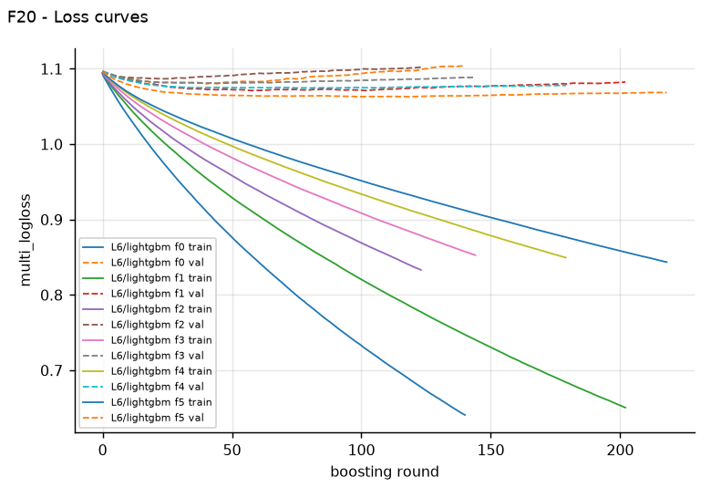

*F20 Loss curves.* Loss curves: train vs inner-validation loss per boosting round (GBDT) and per step/epoch (fine-tuning).

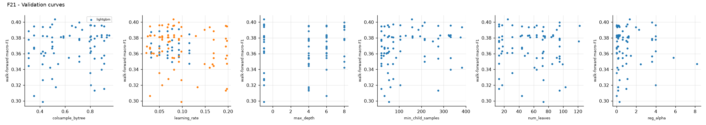

*F21 Validation curves.* Validation curves: walk-forward objective vs each tuned hyperparameter (Optuna trials).

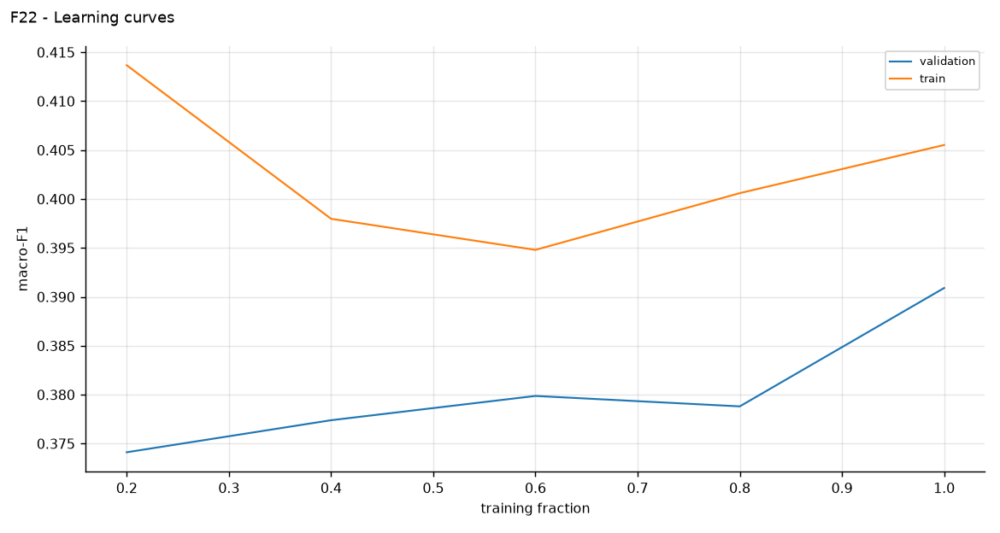

*F22 Learning curves.* Learning curves: validation macro-F1 vs training-set fraction (most recent rows kept).

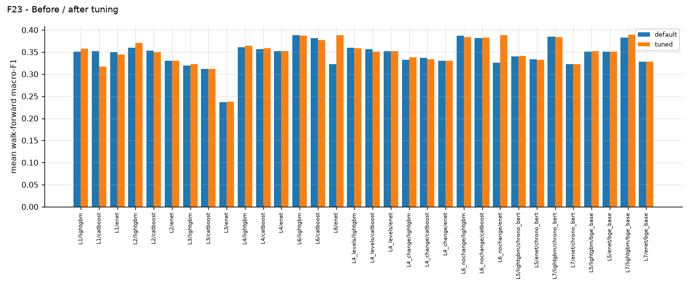

*F23 Before / after tuning.* Before vs after tuning: default vs tuned walk-forward macro-F1 per rung and head.

### Development holdout
| run_id | leaderboard | n_events | accuracy | auc_macro_ovr | ece | logloss | macro_f1 |
|---|---|---|---|---|---|---|---|
| dev/L1 | strict | 7,453 | 0.359 | 0.572 | 0.024 | 1.078 | 0.305 |
| dev/L6 | strict | 7,453 | 0.428 | 0.605 | 0.011 | 1.060 | 0.396 |
| dev/L6_nochange | strict | 7,453 | 0.428 | 0.606 | 0.012 | 1.060 | 0.394 |
| dev/L7 | retrospective | 7,453 | 0.428 | 0.602 | 0.011 | 1.060 | 0.404 |
| ext_stacking/STACK/walk_forward_folds>=1 | retrospective | 24,364 | 0.426 | 0.588 | 0.029 | 1.075 | 0.384 |

### Locked test
Locked test scored once: {
  "scored_at": "2026-10-25T23:59:58.516138+00:00",
  "g4_hash": "d2f47ca5c609602f8f9d5bc4059bde7908ac984a05eac5aa4b8903319f63bffb",
  "reused": false,
  "previous": null
}
| run_id | leaderboard | n_events | accuracy | auc_macro_ovr | ece | logloss | macro_f1 |
|---|---|---|---|---|---|---|---|
| locked/L1 | strict | 8,199 | 0.361 | 0.526 | 0.040 | 1.097 | 0.351 |
| locked/L1/clean_test | strict | 8,199 | 0.361 | 0.526 | 0.040 | 1.097 | 0.351 |
| locked/L6 | strict | 8,199 | 0.401 | 0.590 | 0.009 | 1.071 | 0.384 |
| locked/L6_nochange | strict | 8,199 | 0.403 | 0.591 | 0.011 | 1.071 | 0.386 |
| locked/L6_nochange/clean_test | strict | 8,199 | 0.403 | 0.591 | 0.011 | 1.071 | 0.386 |
| locked/L6/clean_test | strict | 8,199 | 0.401 | 0.590 | 0.009 | 1.071 | 0.384 |
| locked/L7 | retrospective | 8,199 | 0.403 | 0.590 | 0.028 | 1.071 | 0.383 |

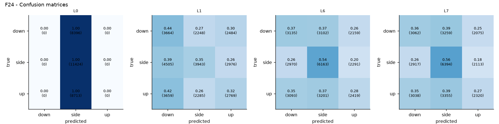

*F24 Confusion matrices.* Confusion matrices (row-normalised) for the selected models.

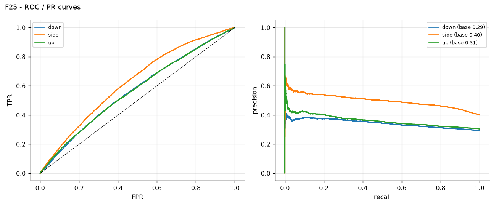

*F25 ROC / PR curves.* One-vs-rest ROC and precision-recall curves for the selected primary model.

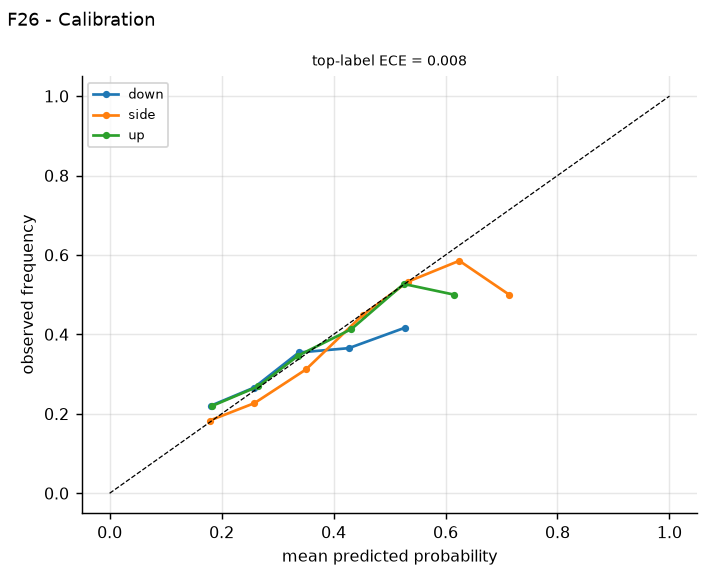

*F26 Calibration.* Calibration: reliability curves and expected calibration error.

### Selective prediction (coverage)
| rung | model_id | revision | tuned | acc_at_10 | acc_at_25 | acc_at_50 | macro_f1_at_10 | macro_f1_at_25 | macro_f1_at_50 |
|---|---|---|---|---|---|---|---|---|---|
| L0 | prior | n/a | default | 0.332 | 0.414 | 0.399 | 0.166 | 0.195 | 0.190 |
| L1 | catboost | n/a | default | 0.504 | 0.455 | 0.403 | 0.236 | 0.250 | 0.334 |
| L1 | catboost | n/a | tuned | 0.482 | 0.429 | 0.367 | 0.228 | 0.294 | 0.347 |
| L1 | enet | n/a | default | 0.525 | 0.474 | 0.399 | 0.266 | 0.289 | 0.352 |
| L1 | enet | n/a | tuned | 0.510 | 0.463 | 0.398 | 0.226 | 0.248 | 0.333 |
| L1 | lightgbm | n/a | default | 0.473 | 0.438 | 0.384 | 0.229 | 0.280 | 0.355 |
| L1 | lightgbm | n/a | tuned | 0.497 | 0.459 | 0.396 | 0.240 | 0.280 | 0.353 |
| L2 | catboost | n/a | default | 0.477 | 0.476 | 0.461 | 0.216 | 0.217 | 0.231 |
| L2 | catboost | n/a | tuned | 0.467 | 0.467 | 0.445 | 0.212 | 0.220 | 0.259 |
| L2 | enet | n/a | default | 0.473 | 0.468 | 0.419 | 0.226 | 0.238 | 0.333 |
| L2 | enet | n/a | tuned | 0.467 | 0.463 | 0.404 | 0.221 | 0.246 | 0.339 |
| L2 | enet | n/a | tuned_transferred | 0.473 | 0.468 | 0.419 | 0.226 | 0.238 | 0.333 |
| L2 | lightgbm | n/a | default | 0.475 | 0.481 | 0.448 | 0.228 | 0.241 | 0.293 |
| L2 | lightgbm | n/a | tuned | 0.482 | 0.478 | 0.449 | 0.217 | 0.229 | 0.290 |
| L3 | catboost | n/a | default | 0.441 | 0.439 | 0.398 | 0.204 | 0.216 | 0.313 |
| L3 | catboost | n/a | tuned | 0.435 | 0.436 | 0.396 | 0.202 | 0.228 | 0.317 |
| L3 | enet | n/a | default | 0.359 | 0.358 | 0.329 | 0.326 | 0.333 | 0.323 |
| L3 | enet | n/a | tuned | 0.428 | 0.423 | 0.405 | 0.200 | 0.198 | 0.251 |
| L3 | lightgbm | n/a | default | 0.440 | 0.417 | 0.360 | 0.208 | 0.275 | 0.336 |
| L3 | lightgbm | n/a | tuned | 0.429 | 0.423 | 0.372 | 0.218 | 0.259 | 0.329 |

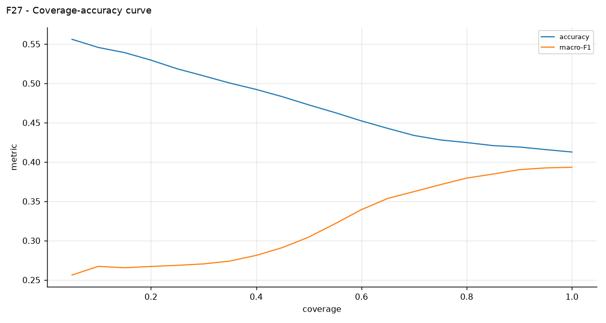

*F27 Coverage-accuracy curve.* Coverage-accuracy curve: accuracy and macro-F1 when only the most confident predictions are kept.

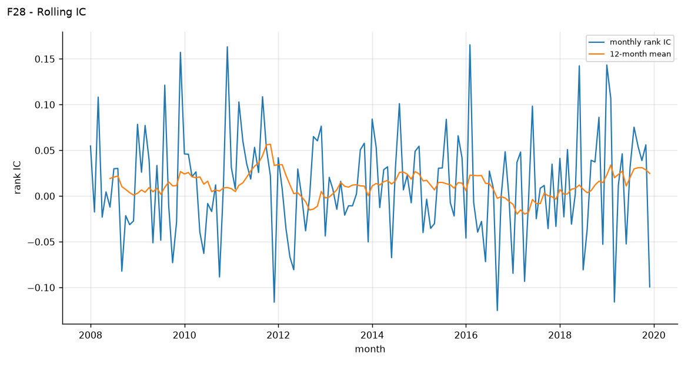

*F28 Rolling IC.* Rolling monthly rank IC of the abnormal-return regression head.

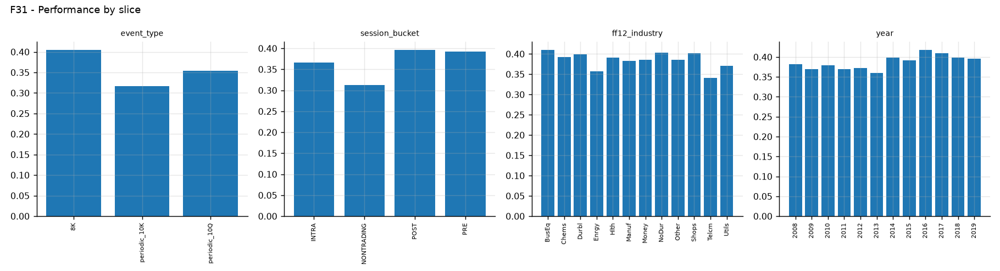

*F31 Performance by slice.* Primary-model macro-F1 by form, category, bucket, timestamp quality, size, sector and year.

### T_info vs T_trade
| rung | model_id | target_def | tuned | value | n_events |
|---|---|---|---|---|---|
| L0 | prior | T_trade | default | 0.191 | 28,533 |
| L1 | lightgbm | T_trade | default | 0.354 | 28,533 |
| L1 | lightgbm | T_trade | tuned | 0.362 | 28,533 |
| L1 | catboost | T_trade | default | 0.358 | 28,533 |
| L1 | catboost | T_trade | tuned | 0.337 | 28,533 |
| L1 | enet | T_trade | default | 0.360 | 28,533 |
| L1 | enet | T_trade | tuned | 0.360 | 28,533 |
| L2 | lightgbm | T_trade | default | 0.374 | 28,533 |
| L2 | lightgbm | T_trade | tuned | 0.379 | 28,533 |
| L2 | catboost | T_trade | default | 0.365 | 28,533 |
| L2 | catboost | T_trade | tuned | 0.367 | 28,533 |
| L2 | enet | T_trade | default | 0.358 | 28,533 |
| L2 | enet | T_trade | tuned | 0.358 | 28,533 |
| L3 | lightgbm | T_trade | default | 0.340 | 28,533 |
| L3 | lightgbm | T_trade | tuned | 0.347 | 28,533 |
| L3 | catboost | T_trade | default | 0.348 | 28,533 |
| L3 | catboost | T_trade | tuned | 0.348 | 28,533 |
| L3 | enet | T_trade | default | 0.284 | 28,533 |
| L3 | enet | T_trade | tuned | 0.345 | 28,533 |
| L4 | lightgbm | T_trade | default | 0.371 | 28,533 |

_32 more rows in the CSV._

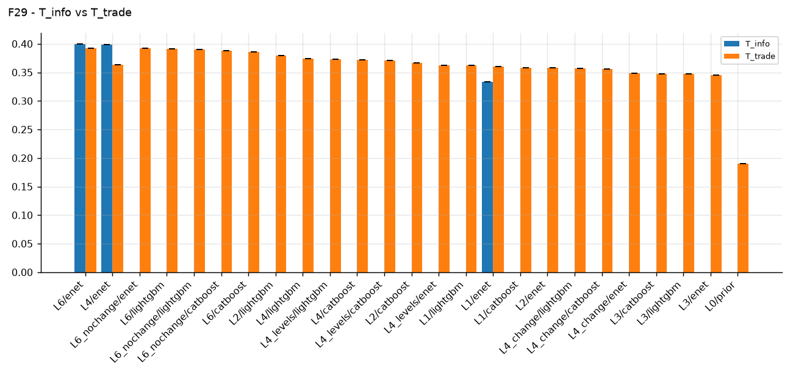

*F29 T_info vs T_trade.* T_info vs T_trade: the same rung scored on the information-response and the tradable target.

### Backtest (economic-relevance check; not an investable strategy)
economic-relevance check, not an investable strategy: shorts are hypothetical (no claim of borrow availability; assumed borrow cost 50 bps/yr), capacity is not modelled, and the survivor-only universe has no delisting returns. Turnover is the mean daily one-way turnover; 'short in cash' = days the short leg had fewer than 10 names and held cash.
| block | lag | cost_bps | leg | ann_return | ann_vol | sharpe | deflated_sharpe_prob | max_drawdown | carhart_alpha_ann | carhart_alpha_t | turnover_long_daily | avg_names_long | avg_names_short | share_days_short_in_cash | n_days |
|---|---|---|---|---|---|---|---|---|---|---|---|---|---|---|---|
| dev | 0 | 10 | long_only | 0.071 | 0.117 | 0.606 | 0.031 | -0.177 | n/a | n/a | 0.074 | 7.404 | 15.923 | 0.276 | 760 |
| dev | 0 | 10 | long_minus_spy_matched | 0.020 | 0.060 | 0.332 | 0.009 | -0.063 | n/a | n/a | 0.074 | 7.404 | 15.923 | 0.276 | 760 |
| dev | 0 | 10 | long_short_hypothetical | -0.027 | 0.166 | -0.162 | 0.001 | -0.354 | n/a | n/a | 0.074 | 7.404 | 15.923 | 0.276 | 760 |
| dev | 0 | 10 | long_hold_component_carhart | 0.243 | n/a | n/a | n/a | n/a | 0.243 | 2.419 | n/a | n/a | n/a | n/a | n/a |
| dev | 0 | 10 | long_short_hold_component_carhart | 0.121 | n/a | n/a | n/a | n/a | 0.121 | 1.229 | n/a | n/a | n/a | n/a | n/a |
| dev | 0 | 10 | long_entry_day_vs_spy_open_close | -0.014 | n/a | n/a | n/a | n/a | n/a | n/a | n/a | n/a | n/a | n/a | 661 |
| dev | 0 | 20 | long_only | 0.052 | 0.117 | 0.447 | 0.016 | -0.181 | n/a | n/a | 0.074 | 7.404 | 15.923 | 0.276 | 760 |
| dev | 0 | 20 | long_minus_spy_matched | 0.001 | 0.060 | 0.022 | 0.002 | -0.081 | n/a | n/a | 0.074 | 7.404 | 15.923 | 0.276 | 760 |
| dev | 0 | 20 | long_short_hypothetical | -0.111 | 0.166 | -0.665 | 0.000 | -0.462 | n/a | n/a | 0.074 | 7.404 | 15.923 | 0.276 | 760 |
| dev | 0 | 20 | long_hold_component_carhart | 0.243 | n/a | n/a | n/a | n/a | 0.243 | 2.419 | n/a | n/a | n/a | n/a | n/a |
| dev | 0 | 20 | long_short_hold_component_carhart | 0.121 | n/a | n/a | n/a | n/a | 0.121 | 1.229 | n/a | n/a | n/a | n/a | n/a |
| dev | 0 | 20 | long_entry_day_vs_spy_open_close | -0.014 | n/a | n/a | n/a | n/a | n/a | n/a | n/a | n/a | n/a | n/a | 661 |
| dev | 1 | 10 | long_only | 0.118 | 0.118 | 1.000 | 0.110 | -0.084 | n/a | n/a | 0.074 | 7.404 | 15.923 | 0.276 | 760 |
| dev | 1 | 10 | long_minus_spy_matched | 0.037 | 0.062 | 0.588 | 0.027 | -0.047 | n/a | n/a | 0.074 | 7.404 | 15.923 | 0.276 | 760 |
| dev | 1 | 10 | long_short_hypothetical | 0.071 | 0.173 | 0.408 | 0.013 | -0.287 | n/a | n/a | 0.074 | 7.404 | 15.923 | 0.276 | 760 |
| dev | 1 | 10 | long_hold_component_carhart | 0.234 | n/a | n/a | n/a | n/a | 0.234 | 2.405 | n/a | n/a | n/a | n/a | n/a |
| dev | 1 | 10 | long_short_hold_component_carhart | 0.224 | n/a | n/a | n/a | n/a | 0.224 | 2.183 | n/a | n/a | n/a | n/a | n/a |
| dev | 1 | 10 | long_entry_day_vs_spy_open_close | -0.000 | n/a | n/a | n/a | n/a | n/a | n/a | n/a | n/a | n/a | n/a | 661 |
| dev | 1 | 20 | long_only | 0.099 | 0.117 | 0.843 | 0.067 | -0.088 | n/a | n/a | 0.074 | 7.404 | 15.923 | 0.276 | 760 |
| dev | 1 | 20 | long_minus_spy_matched | 0.018 | 0.062 | 0.289 | 0.008 | -0.052 | n/a | n/a | 0.074 | 7.404 | 15.923 | 0.276 | 760 |

_28 more rows in the CSV._

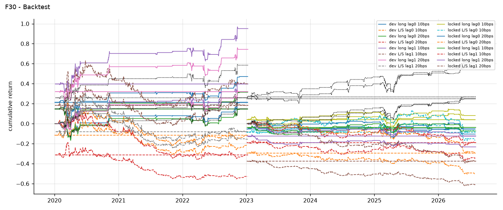

*F30 Backtest.* Backtest: cumulative long-only (vs interval-matched SPY) and hypothetical long-short returns, by cost level and with a one-session lag.

### Index membership: S&P 500 vs non-S&P 500 vs combined
Only one index bucket exists in this universe (every firm is an S&P 500 member), so the S&P-vs-non-S&P comparison does not apply to this study; it is part of the 500-firm design. Composition:

| sp_bucket | firms | events | events_per_firm | share_8k | share_10q | share_10k | share_verified_earnings | share_ts_quality_A | member_at_event_share | first_year | labelled_T_trade_h1 | share_up | share_down | median_log_mcap | median_vol_60 | sue_available_share | label |
|---|---|---|---|---|---|---|---|---|---|---|---|---|---|---|---|---|---|
| Combined | 150 | 60,261 | 401.740 | 0.750 | 0.187 | 0.063 | 0.239 | 0.959 | 0.706 | 2000 | 59,698 | 0.300 | 0.294 | 23.530 | 0.017 | 0.311 | Combined (all firms) |
| SP500 | 150 | 60,261 | 401.740 | 0.750 | 0.187 | 0.063 | 0.239 | 0.959 | 0.706 | 2000 | 59,698 | 0.300 | 0.294 | 23.530 | 0.017 | 0.311 | S&P 500 members (in the study window) |

## 6. Track C: content validity
Gold set: single-rater, provisional; labels imported: False. G3b: passed False (no gold-val labels). Price outcomes never validate semantic labels.
| metric | status |
|---|---|
| all | not evaluated: gold-test labels and a frozen RAG pipeline are both required |

*F32 Retrieval metrics by setup: not produced: not evaluable without gold-val qrels*

*F33 Extraction F1 / faithfulness (gold-test): not produced: gold-test not evaluated*

*F34 Numeric fidelity: not produced: needs gold labels (Track C)*

*F35 Judge vs human: not produced: needs gold labels (Track C)*

*F36 Student vs teacher vs human: not produced: needs gold labels (Track C)*

## 7. Fit diagnostics
| rung | head | mean_val | mean_train | std | verdict |
|---|---|---|---|---|---|
| L1 | lightgbm | 0.358 | 0.507 | 0.018 | overfit |
| L1 | catboost | 0.318 | 0.452 | 0.062 | overfit, unstable |
| L1 | enet | 0.345 | 0.352 | 0.029 | good fit |
| L2 | lightgbm | 0.371 | 0.397 | 0.022 | good fit |
| L2 | catboost | 0.350 | 0.407 | 0.027 | good fit |
| L2 | enet | 0.331 | 0.358 | 0.066 | unstable |
| L3 | lightgbm | 0.323 | 0.329 | 0.050 | unstable |
| L3 | catboost | 0.312 | 0.288 | 0.072 | unstable |
| L3 | enet | 0.238 | 0.225 | 0.074 | unstable |
| L4 | lightgbm | 0.365 | 0.483 | 0.026 | overfit |
| L4 | catboost | 0.359 | 0.555 | 0.025 | overfit |
| L4 | enet | 0.352 | 0.381 | 0.035 | unstable |
| L6 | lightgbm | 0.387 | 0.581 | 0.019 | overfit |
| L6 | catboost | 0.378 | 0.647 | 0.013 | overfit |
| L6 | enet | 0.389 | 0.408 | 0.010 | good fit |
| L4_levels | lightgbm | 0.359 | 0.456 | 0.033 | unstable |
| L4_levels | catboost | 0.351 | 0.516 | 0.043 | overfit, unstable |
| L4_levels | enet | 0.352 | 0.375 | 0.026 | good fit |
| L4_change | lightgbm | 0.338 | 0.405 | 0.038 | unstable |
| L4_change | catboost | 0.334 | 0.426 | 0.038 | unstable |
| L4_change | enet | 0.331 | 0.335 | 0.045 | unstable |
| L6_nochange | lightgbm | 0.384 | 0.558 | 0.010 | overfit |
| L6_nochange | catboost | 0.382 | 0.587 | 0.018 | overfit |
| L6_nochange | enet | 0.388 | 0.407 | 0.010 | good fit |

**Optimisation diagnostics.** Elastic-net certificate: objective spread across random starts 1.68e-09 -> global optimum of the convex problem certified. Tree and transformer heads are non-convex: their optima are validation-selected (best Optuna trial / early-stopped checkpoint), not global minima.

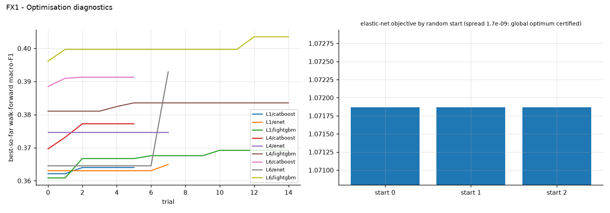

*FX1 Optimisation diagnostics.* Supplementary - optimisation diagnostics: Optuna best-so-far objective per trial and the elastic-net convexity certificate (equal objective from several random starts = global optimum of that convex problem; tree and transformer optima are validation-selected, not global).

## 8. Extensions run
| extension | enabled |
|---|---|
| ext_stacking | 1 |

## 9. Limitations, resource use, decision log
- Association is not causation; prediction is not profitability; the backtest is an economic-relevance check only.
- Public availability times are assumed (acceptance + 5 min), not observed; results carry that timing policy.
- Pretrained encoders without documented cutoffs (FinBERT-tone, BGE, Qwen, ModernBERT) appear only on the retrospective leaderboard and support no clean-test claim.
- MCS / PBO are diagnostics only: {"mcs": {"included": ["L6_nochange", "L7", "STACK"], "pvalues": {"L1": 0.0, "L6": 0.006, "L6_nochange": 0.282, "L7": 0.282, "STACK": 1.0}, "n_blocks": 36, "method": "arch.bootstrap.MCS (Hansen-Lunde-Nason)", "streams": "monthly mean log-loss on the development holdout, finalists only"}, "pbo": {"pbo": 0.0, "n_combinations": 70, "n_configs": 93, "n_blocks": 144, "logit_median": 3.1135153092103756, 
- The GPU part ran in FAST mode (decision log D-074): encoders ['chrono_bert', 'bge_base'] instead of the four-model core roster, heads ['lightgbm', 'enet'] (no CatBoost), tuning trials {'lightgbm': 8, 'enet': 4}, and no fine-tuning even if G3 passes. The L5/L7 comparison and H1/H3/H4 therefore rest on fewer encoders and a lighter search than the spec's core study; the structured baselines (L0-L6) and Track A are unaffected.
| stage | wall_s | status |
|---|---|---|
| S00 | 11.600 | done |
| S01 | 0.500 | done |
| S02 | 89.800 | done |
| S03 | 29.400 | done |
| S04 | 105.800 | done |
| S05 | 75.400 | done |
| S06 | 373.800 | done |
| S07 | 131.500 | done |
| S08 | 152.000 | done |
| S09 | 408.600 | done |
| S10 | 5.100 | done |
| S11 | 7365.700 | done |
| S12 | 13.500 | done |
| S20 | 195.800 | done |
| S21 | 64.200 | done |
| S24 | n/a | failed |
| S13 | 18.400 | done |
| S14 | 5946.400 | done |
| S15 | 2947.800 | done |
| S16 | 7126.300 | done |
| S17 | 0.000 | done |
| S18 | 137.900 | done |
| S19 | 158.100 | done |
| S22 | 403.700 | done |
| S23 | 0.000 | done |

Decision log: `docs/decision_log.md`

## 10. What the results mean: answers to the research questions
**Are the accuracies good?** On the locked test the best structured model (L6) scores macro-F1 0.384 (chance 0.328), accuracy 0.401 (always-Sideways 0.366), AUC 0.590, calibration error 0.009. That is a modest but real above-chance result of the size usually seen in daily return prediction, it holds up from the walk-forward folds to the locked test, and it is almost entirely a 'will it move' signal, not a 'which way' signal.

**Were the spec requirements met?** The ablation ladder L0-L7, point-in-time availability rules, purge and embargo, the planted-leak audit, the G4 freeze and the single-use locked test were executed and are documented. Not met: Track C (no gold labels), so L8, G3b, RAG evaluation, H3 and H6 are untested; the firm- and sector-held-out stress folds were built but not scored; the run used the fast-mode roster (two of four encoders) on 150 firms. Details in section 11.

**Did we answer the post-earnings-drift question?** Sorting earnings releases by SUE, the high-surprise quintile underperformed the low-surprise quintile by -2.63% [-3.50%, -1.70%] over days +2 to +60 (n = 3,825, verdict 'supported'). That is a **reversal**, the opposite of classic continuation. Because the universe contains only firms that survived to 2026, firms that kept falling after bad news and were delisted are missing, which biases low-SUE drift upwards; these data cannot separate that bias from a genuine reversal. The backtest does not turn this into a tradable edge.

**Did text add value beyond structured numbers (H1)?** No. Paired lift of the best text model over the best structured model: walk-forward 2008-2019 -0.001 [-0.007, 0.005]; development 2020-2022 +0.007 [-0.001, 0.016]; locked 2023-2026 -0.001 [-0.012, 0.009]. Every interval includes zero and the gate G3 (+0.01 with CI above 0) failed, so no encoder was fine-tuned. Annual ChronoBERT vintages did not differ detectably from the static BGE encoder (H4).

**Is the study complete and defensible?** It is a complete, reproducible empirical study of Tracks A and B with a credible null result for text, and an incomplete Track C. See 'Smallest defensible claim' above and the caveats in section 11.

## 11. Known issues, reproducibility and next steps
- **Cross-machine reproducibility of tree models.** The same L6 model re-scored in S11 (CPU stage, local PC) and S15 (GPU stage, Colab) on identical events and folds: lightgbm: 80.2% identical predicted classes, mean |dp| 0.0195, macro-F1 0.390 vs 0.394; enet: 98.1% identical predicted classes, mean |dp| 0.0015, macro-F1 0.392 vs 0.393. Multi-threaded boosting and library versions are the probable causes (not isolated). Effect sizes in this report are far larger than this noise except for the L6/L7 selection margin.

- **Final-model selection.** The rule compares the L6 walk-forward score from S11 with the L7 score from S15, computed in different runs, and has no tie-break in favour of the strict leaderboard (see section 5a).

- **Stress folds.** Firm-held-out and sector-held-out folds are built in S10 but their scores were not produced in this run; the leakage audit item 4 is relabelled 'built, not scored' in this report.

- **Locked-test comparisons.** S19 scores the frozen finalists but does not compute the paired H1/H2 lifts; they are computed in section 5a from the stored locked predictions.

- **Lockbox.** Scored once (2026-10-25T23:59:58Z, reused=False, previous=None), 2.6 minutes after the freeze, in the same run and straight after the development stage. The spec requires the freeze (G4) to precede scoring, which holds; the project's own guidance was to review the development results before unlocking, which did not happen in this run. The period is now spent: any re-run can only score it as development data.

- **Track C and RAG.** No gold labels were imported, so content validity, retrieval and extraction quality, the student model, L8 and hypotheses H3 and H6 are not evaluated (figures F32-F36 are marked 'not produced').

- **Fast mode.** Two of four core encoders (SEC-BERT, FinBERT-tone) and CatBoost on embeddings were dropped, tuning trials were reduced and fine-tuning was disabled (decision D-074); all conclusions about text refer to ChronoBERT and BGE only.

- **Environment record.** The environment manifest was written by the local PC run and does not describe the Colab session; the GPU model was not recorded. S13 records device 'cuda' and a benchmark in chunks/s.

- **Survivor-only universe, daily bars, 150 firms.** See sections 1 and 9. Drift and backtest results are biased towards survivors; confidence intervals are about twice as wide as with 500 firms.

- **History.** An earlier 500-firm run predates the point-in-time accounting fix (D-077); its accounting-dependent results are superseded and are not used here.

**Recommended next steps**

1. Move to the 500-firm study (S&P and non-S&P buckets, more power) after the fixes below.
2. Make LightGBM deterministic (fixed thread count, `deterministic=True`) and compare finalists inside one run.
3. Add a tie-break that prefers the strict model when walk-forward scores differ by less than the measured noise.
4. Score the firm- and sector-held-out stress folds and add the locked-test paired lifts to S19.
5. Annotate the gold set (templates are pre-filled) to enable G3b, L8, H3, H6 and Track C.
6. Add delisted firms' prices to remove the survivor-only limitation.

## Appendix: decision log, file map and how to re-run
**How to re-run.** Open the notebook, set `RUN_PROFILE = "full"`, `N_STOCKS`, `SPEED` and `PART` in the first cell and run all; finished stages are skipped. Locally: `secprice run --profile full --stages S00-S24` with `SEC_USER_AGENT` set to 'Name email'. Tests: `pytest -m "not network"`.

**File map.** Each stage writes to `<DATA_ROOT>/<profile>/<stage>/<hash>/`; reports are in `reports/` (this document as .md, .html, .pdf; figures in `reports/figures/`), provenance in `manifests/` (run manifest, environment manifest, frozen architecture and G4 hash, pre-registration hash, lockbox log).

| stage | name | main outputs |
|---|---|---|
| S00 | env / config / prereg check | environment_manifest.json, config_resolved.json |
| S01 | Hugging Face dataset audit | hf_census.parquet, hf_dataset_audit.md |
| S02 | Universe | universe.parquet, firms_per_year.csv, submissions/ |
| S03 | Calendar, prices, actions, factors | calendar.parquet, prices.parquet, corporate_actions.parquet |
| S04 | EDGAR index + coverage audit | filing_manifest.parquet, coverage_firm_year.csv, ts_quality_by_year.csv |
| S05 | Download + parse + taxonomy + anonymize | sections/<cik>.parquet, exhibits/<cik>.parquet, ledger/<cik>.parquet |
| S06 | XBRL + release EPS + SUE | xbrl_facts.parquet, eps_release.parquet, sue_by_accession.parquet |
| S07 | Events + clocks | events.parquet, usable_cutoff.json, event_counts.csv |
| S08 | Targets + labels | targets.parquet, target_summary.csv |
| S09 | Structured + lexical features | features.parquet, feature_registry.csv, event_text.parquet |
| S10 | Splits + cohorts + leakage audit | splits.parquet, blocks.csv, fold_provenance.csv |
| S11 | Baselines L0-L4, L6 | predictions.parquet, results_long.parquet, ladder_summary.csv |
| S12 | Gold export / import | gold_sample.parquet, templates/ |
| S13 | Preflight (GPU) | preflight.json |
| S14 | Core embeddings + vintage ChronoBERT | embeddings/<encoder>/vectors.npy, index.parquet, extra.parquet |
| S15 | L5 / L7 heads + tuning; G3; fine-tune top 2 | results_long.parquet, predictions.parquet, g3.json |
| S16 | Core RAG: retrieval eval, extraction (gold-val), freeze | rag_tournament.csv, g3b.json, rag_frozen.json |
| S17 | Teacher sample + student distillation -> L8 | extractions.parquet, ext_features.parquet, student_report.json |
| S18 | Development holdout + diagnostics (MCS / PBO) + G4 freeze | dev_results.parquet, frozen_architecture.json, mcs_pbo.json |
| S19 | unlock-test: retrain + locked test + clean test | locked_results.parquet, lockbox_log.json |
| S20 | Track A event study + correlations + topics | track_a_cars.parquet, track_a_groups.csv, car_paths.csv |
| S21 | Drift tests | hypothesis_tests.csv |
| S22 | Backtest | backtest.csv, backtest_daily.parquet |
| S23 | Track C final (gold-test) | content_validity.csv |
| S24 | Figures + report | reports/results_summary.md, reports/results_report.html, reports/results_report.pdf |

**Decision log (summary).** The full log with rationales is `docs/decision_log.md`.

| id | decision (first sentence) |
|---|---|
| D-001 | Deliverable runs end to end from one Colab notebook that embeds this repository (package, configs, tests); the repository also runs locally (secprice CLI, pytest) |
| D-002 | study.end = 2026-07-31 (owner: Jan 2000 - Jul 2026) |
| D-003 | Acceptance time: the submissions-JSON acceptanceDateTime (suffix Z) is the Eastern wall time shifted by the ET->UTC offset twice (+8 h EDT, +10 h EST) |
| D-004 | "The Hugging Face repository" = JanosAudran/financial-reports-sec (named in every owner spec) |
| D-005 | Universe: our 979 OHLCV tickers mapped to CIK (SEC company_tickers_exchange.json, HF tickers fallback) -> in the HF 10-K corpus (736 firms) -> domestic 10-K/10-Q filers with prices in the wi |
| D-006 | Prices: local TriFrame final/1day bars (split-adjusted, verified vs Yahoo) are primary; yfinance (auto_adjust=False, actions=True, back_adjust=False, repair=False) supplies the 1998-2000 war |
| D-007 | Primary Track B target = T_trade, h = 1, 3-class (addendum P0.1) |
| D-008 | T_trade abnormal return = R_stock - beta x R_SPY on the identical open->close interval (alpha omitted on partial-day intervals) |
| D-009 | "Last regular-session close before acceptance" uses close <= acceptance (a close printed at the acceptance instant counts as before). |
| D-010 | Artifact folders are keyed by a stage-scoped hash (the config keys the stage reads + upstream stage hashes); the global config hash is stamped on every artifact manifest. |
| D-011 | Download strategy: 10-K/10-Q primary document (full submission .txt when the primary is missing or 404); for 10-Ks whose MD&A is missing, by reference or < 15k characters, the full submissio |
| D-012 | Sections: 10-K Items 1, 1A, 7, 7A; 10-Q Part I Items 2-3 and Part II Item 1A; 8-K item text and EX-99 exhibits |
| D-013 | Anonymization: firm names (current + former) and tickers masked by regex in S05; NER PER/ORG masking (dslim/bert-base-NER) is available but off by default (models.ner_mask), because it doubl |
| D-014 | accounting.predecessor_lookback = 4 years, separate from text.predecessor_lookback = 2 (addendum P1.4) |
| D-015 | Release EPS: diluted GAAP EPS from EX-99 tables (preferred) or prose ("$.26 per diluted share", "(assuming dilution) were $2.09"); rows mentioning non-GAAP / adjusted / excluding are skipped |
| D-016 | Verified earnings release = 8-K item 2.02 (or legacy item 12 after 2003-03-28; legacy items 5/7/9 only with confirmed results content) + results-release exhibit + timestamp quality A |
| D-017 | Cluster = a verified release + the firm's next 10-Q/10-K filed within 120 days whose report date is within 20 days of the release quarter end. |
| D-018 | Overlap flags anchor on Track A day 0 (dates only). |
| D-019 | Embargo is implemented as a gap: training events with decision dates in the 90 days before each test block are excluded, in addition to purging any training event whose T_info/T_trade window |
| D-020 | Common cohort = events eligible for every compared rung: price features present, accounting available (any point-in-time XBRL fact or SUE), text sections present (and embeddings for L5/L7) |
| D-021 | Tuning (Optuna TPE + median pruner, SQLite) runs on the common cohort for the primary target with the same budget per rung/encoder; the maximum-available cohort and secondary targets reuse t |
| D-022 | Decision rule: heads train with class-balanced weights; their probabilities are prior-corrected to true frequencies, temperature-calibrated on an inner training slice, and the cost-balanced  |
| D-023 | Early stopping, calibration and clip bounds use an inner, time-ordered slice of the training fold; hyperparameters are selected on walk-forward validation blocks. |
| D-024 | Embedding pooling: mean and max over section-aware chunks (learned attention pooling is not implemented in the core). |
| D-025 | The fine-tuned encoder is its own candidate (rung L8_ft), scored directly; its walk-forward OOF probabilities feed the stacking extension |
| D-026 | Faithfulness judge = cross-encoder/nli-deberta-v3-base (Apache-2.0), added to the ledger. |
| D-027 | LLM inference: transformers + lm-format-enforcer JSON-schema-constrained decoding; vLLM is not used (installing it reinstalls torch on Colab) |
| D-028 | ext_stacking (H5) is enabled by owner request ("group the best models together"); gate G3c recorded (core complete; budget; pre-stated question H5) |
| D-029 | The lockbox is sealed by default (lockbox.unlock_locked_test: false) |
| D-030 | "Global minima": convex heads (elastic-net logistic) get a certificate (equal penalized objective from several random starts); tree and transformer optima are validation-selected and are nev |
| D-031 | Loughran-McDonald 1993-2025 dictionary from the official SRAF Google-Sheet export (sha256 147cb24a...); the CSV link hit a Drive quota on 2026-10-23 |
| D-032 | Backtest signal = the frozen architecture refitted on T_trade h=5 labels (horizon matches the 5-session hold); when the primary model is fine-tuned or stacked, the best tabular finalist is u |
| D-033 | Drift lag robustness uses CAR[+3,+61] (one-session lag); spread costs = 4 x bps (two legs, in and out). |
| D-034 | Python 3.12 (Colab's version at build time) instead of 3.11. |
| D-035 | Smoke profile: five fixed tickers (AAPL, MSFT, JNJ, XOM, JPM), 2021-2023; offline integration smoke uses a deterministic synthetic world (tests/). |
| D-036 | Filing-change similarity uses a fixed hashing space (no fitted vocabulary, so nothing is learned from the future); TF-IDF + SVD are fitted inside each fold. |
| D-037 | Without gold labels, Track C metrics are "not evaluated", G3b cannot pass and S17 (teacher/student, L8) does not run unless rag.run_extraction_without_gold: true (labelled exploratory) |
| D-038 | A firm keeps every CIK it filed under: the SEC's current ticker map and the HF corpus can disagree after a reorganisation (verified: XOM -> new holding-company CIK 2115436, history under 340 |
| D-039 | S14 builds a chunk store once (one read per firm file, partitioned by event year on local disk); encoders stream it year by year (ChronoBERT loads each vintage once). |
| D-040 | Stage hashes use only the config keys a stage reads (S05 no longer depends on text.model_text_chars), so model-side settings never invalidate the EDGAR download |
| D-041 | Tuning budget for full: LightGBM 15, CatBoost 6, elastic-net 8 trials per rung on L1, L2, L3, L4, L6 (median pruning); L4_levels / L4_change / L6_nochange reuse the parent rung's tuned param |
| D-042 | Gate G2 "pilot completed" = the pilot's S18 (development holdout) succeeded; full.owner_opt_in_full: true is always required. |
| D-043 | Optuna SQLite studies live on local disk (HOT_ROOT) and are copied to the stage folder at the end (SQLite is unsafe on the Drive FUSE mount) |
| D-044 | Encoder / tokenizer loading falls back to the BERT classes when a checkpoint's config lacks model_type (yiyanghkust/finbert-tone under transformers 5) |
| D-045 | LLM extraction is batched (16 prompts, left padding, OOM halving, per-item JSON retry) and checkpointed through the response cache every 64 filings. |
| D-046 | Release-EPS parser fixes from real releases: values are read after the label cell (keeps "(0.15)" negatives), a lone "Diluted" label line is joined with the numeric line below it (Apple 2020 |
| D-047 | Correction to D-003 |
| D-048 | Release-EPS parser, second round from 2,086 pilot comparisons with XBRL (65% match before): a "(" marks a negative even when ")" is in the next cell; share-count rows are skipped; rows under |
| D-049 | Tuning screen for full: Optuna trials score the 3 most recent walk-forward folds with a time-stratified subsample of at most 30,000 training rows per fold (a budget-driven deviation from SPE |
| D-050 | Adversarial validation is reported twice: with all features and with firm-level features only (market-wide mkt_* and calendar fields removed) |
| D-051 | Adversarial validation also records the five features that separate train from validation (gain share), and the report reads a high AUC as covariate shift, not leakage |
| D-052 | Early-era real-data run (2000-2004; AAPL, XOM, AXP, IBM, PFE, INTC; 361 filings, 317 events) found two defects that the pilot (2012+) and fixtures could not |
| D-053 | Early-era data limits, expected and handled per spec rather than defects: filings before ~2003 have no SGML acceptance time in a usable form (quality B date-only or C), so 2000-2002 events a |
| D-054 | Reproducibility: all 26 ChronoBERT vintages are pinned to Hub commit SHAs and S14 refuses an unpinned revision; requirements.lock records the tested versions; the notebook installs exact pin |
| D-055 | sec.s05_max_wall_hours (notebook default 8, config default 0 = unlimited): S05 stops cleanly after that many hours with StageIncomplete (recorded as "incomplete", not "failed"); running the  |
| D-056 | Owner decision (2026-10-23): keep 500 firms and analyse the index buckets |
| D-057 | Survivor-only universe, stated as such (audit H1): the OHLCV set holds current listings only, so firms that delisted, merged or were acquired before 2026 are absent |
| D-058 | Owner decision (2026-10-23): no pilot gate |
| D-059 | Provenance (audit M3): git_commit appends -dirty when src/configs/tests have uncommitted changes; code_hash normalises line endings; every artifact manifest lists the upstream stage hashes a |
| D-060 | Process deviation, recorded (audit M4): milestones M0-M13 were committed as one commit (c1d5b3a) instead of one commit per milestone (§0.1.2, §22) |
| D-061 | Smoke profile: AAPL, MSFT, JNJ, XOM + GPI (Group 1 Automotive, not in the fja05680 list) |
| D-062 | The pilot profile's fine-tuning grid has 2 trials (§9.4 asks 6-12 for the study); pilot = small samples |
| D-063 | filing_manifest_timed.parquet (S07) completes the §16 filing-manifest contract: acceptance time, timestamp quality, period of report, items source, URL, checksum and parse status are known o |
| D-064 | The pre-registered ECE guardrail (ece_max 0.10) is evaluated next to the log-loss guardrail (guardrail_ece_ok, guardrail_logloss_ok in results_long and a report table). |
| D-065 | Layout: tools/write_docs.py writes docs/stage_cards/S00..S24.md and docs/annotation_guide.md (run-specific cards stay next to the artifacts); configs/lexicons/README.md points to the Loughra |
| D-066 | Release-EPS parser, third round, from the 2005-2011 real-data run (12 firms, 6 S&P + 6 non-S&P) and a replay over all 3,360 pilot and early-era releases against XBRL: (1) losses: when "loss" |
| D-067 | Preflight LLM projection follows the G3b rule: the teacher extraction (llm_teacher_filings, 3,000) is counted only when gold labels exist in inputs/gold or rag.run_extraction_without_gold is |
| D-068 | Defects found by the full 500-firm run (2026-10-23/24), all fixed with regression tests: (1) S05 workers built their SEC client without sec.cache_max_bytes, so the full profile's cache cap w |
| D-069 | Full-run S05 throughput: downloads are latency-bound, so sec.max_parse_workers (default 8) caps the process count and each process gets max_rps / processes; the local run used 12 processes a |
| D-070 | Full profile, Part 1 S05 result: 500 firms, 202,607 filings (149,992 8-K, 39,373 10-Q, 13,242 10-K), 201,728 parsed with sections, 879 with no target section, 0 errors after the retry; 385,3 |
| D-071 | Point-in-time defect found by the full run's availability assertion (S09): a same-day group of 8-Ks is one event (§5.2) whose features use every filing in it (text, item categories, release  |
| D-072 | Hard-rule-7 defect found by the full run's SUE-rule assertion (S09): S06 computes SUE per accession before clusters exist (S07), so when a firm filed its 10-Q minutes after the earnings 8-K  |
| D-073 | Drift-verdict audit of the full run (hard rule 10: a surprising result opens an audit) |
| D-074 | Owner decision (2026-10-25): a speed switch for the GPU part, because a full-depth run was estimated at 15-25 h of Colab time |
| D-075 | Preflight benchmark defect found on the owner's first Colab run (A100 requested): benchmark timed one cold pass over 256 chunks, so the one-off GPU start-up cost (CUDA context, kernel select |
| D-076 | Owner decision (2026-10-26): a 150-stock S&P 500 mini study to finish a complete version in about a day |
| D-077 | Accounting-feature defect, found by comparing the 150-firm run with the 500-firm run it was derived from (same firms must give identical features; six did not, in 35-52% of rows) |
| D-078 | Report v2 for the 150-firm study (owner request: a complete end-to-end report with every visual, step and output) |

## Figure index
- **A01** Pipeline architecture: 25 stages in three parts. System architecture: the 25 stages in three parts (CPU data and baselines, GPU embeddings and RAG, CPU holdout/locked test/report) with the wall time of the run that produced each result. Orange dashed = ran but produced no result because gold labels are missing.
- **A02** Data and pre-processing flow. Data and pre-processing flow from sources to features; counts are read from the run.
- **A03** Ablation ladder L0-L8. The ablation ladder L0-L8: what each rung adds, its walk-forward macro-F1, and whether it is on the strict (green) or retrospective (red) leaderboard.
- **A04** RAG and extraction system. The retrieval-augmented extraction system: retrieval (BM25 + dense + fusion + rerank), constrained generation, guardrails, cache and annotation templates; dashed grey stages need human gold labels and were not run.
- **R01** Macro-F1 against its real chance level. Macro-F1 of L1, L6 and L7 in each period against the real chance level (shuffled own predictions), the majority-class baseline and the permutation null.
- **R02** Move versus direction skill. Two AUCs per model and period: does the stock move (move vs sideways) and which way (up vs down among moved events). 0.5 = no information; bars are month-block bootstrap 95% CIs.
- **R03** Paired lifts by period. Paired macro-F1 lifts on identical events in each period (text over structured, change features, structured over price-only) with 95% month-block bootstrap CIs.
- **R04** Compute time by stage. Wall-clock hours per stage. Part 1 ran on a 12-core PC, Parts 2 and 3 on Colab.
- **R05** Universe by Fama-French 12 industry. Universe: number of firms per Fama-French 12 industry.
- **R06** Qwen pre-fill: how often each field was extracted. Share of pre-filled filings in which Qwen extracted each field as present. Unvalidated model output (no gold labels), shown only to describe what the pipeline produces.
- **F01** Coverage heatmap (parsed share). Coverage heatmap: share of observed filings that parsed into at least one section, by year x form. Pale cells = parser or download gaps.
- **F02** Audit reason codes over time. Audit reason codes by year (periodic-filing expectations only; 8-Ks have no expectation).
- **F03** 8-K category availability by year. 8-K category availability by year under taxonomy v1 (legacy items before 2004-08-23).
- **F04** Universe: unique firms vs firms per year. Universe: unique firms (constant) vs firms with prices and firms in the S&P 500 each year. Survivor-only universe (current listings; survivorship-biased).
- **F05** Timestamp quality and session buckets by year. Timestamp quality (A exact / B date-only / C uncertain) and session buckets by year.
- **F06** Pre-publication window and lag sensitivity. Pre-publication window (last close -> acceptance) and the share of events whose clock changes under public-lag sensitivity.
- **F07** Event-clock diagram. Event-clock diagram: acceptance, assumed public time, decision time; T_info base/exit; T_trade entry/exit.
- **F08** Earnings types over time. Earnings event types over time (verified releases, periodic-only, ambiguous).
- **F09** Overlap counts and clean share. Same-firm overlap counts by horizon and the clean-event share.
- **F10** Target distributions and class balance. Target distributions (abnormal returns) and 3-class balance by target definition.
- **F11** CAR paths by event type (all vs clean). Average cumulative abnormal return path (market model) around day 0 by event type, all events vs clean events.
- **F12** CAR[0,+1] by session bucket. CAR[0,+1] by session bucket (INTRA day 0 is a mixed pre/post interval).
- **F13** Pre-trend diagnostics. Pre-trend diagnostics: CAR[-20,-2] and CAR[-5,-1] by event type (interpreted, not forced to zero).
- **F14** Abnormal volume and volatility response. Abnormal log volume and volatility response on days [0,+1] by event type.
- **F15** Correlation heatmap. Spearman correlations between text features and event-window CARs (association only).
- **F16** SUE-drift quintile CAR[+2,+60]. SUE-conditioned post-earnings drift: CAR[+2,+60] by SUE_release quintile (prior-quarter breakpoints).
- **F17** Split timeline. Split timeline: walk-forward validation blocks, purge/embargo gap, development holdout, locked test; per-fold strict/retrospective labels.
- **F18** Ladder lift with CIs. Ablation ladder: walk-forward macro-F1 by rung with month-block bootstrap CIs (common and maximum-available cohorts).
- **F19** Vintage vs static (H4). H4: point-in-time ChronoBERT vintages vs static encoders on identical rows and heads.
- **F20** Loss curves. Loss curves: train vs inner-validation loss per boosting round (GBDT) and per step/epoch (fine-tuning).
- **F21** Validation curves. Validation curves: walk-forward objective vs each tuned hyperparameter (Optuna trials).
- **F22** Learning curves. Learning curves: validation macro-F1 vs training-set fraction (most recent rows kept).
- **F23** Before / after tuning. Before vs after tuning: default vs tuned walk-forward macro-F1 per rung and head.
- **F24** Confusion matrices. Confusion matrices (row-normalised) for the selected models.
- **F25** ROC / PR curves. One-vs-rest ROC and precision-recall curves for the selected primary model.
- **F26** Calibration. Calibration: reliability curves and expected calibration error.
- **F27** Coverage-accuracy curve. Coverage-accuracy curve: accuracy and macro-F1 when only the most confident predictions are kept.
- **F31** Performance by slice. Primary-model macro-F1 by form, category, bucket, timestamp quality, size, sector and year.
- **F28** Rolling IC. Rolling monthly rank IC of the abnormal-return regression head.
- **F29** T_info vs T_trade. T_info vs T_trade: the same rung scored on the information-response and the tradable target.
- **F30** Backtest. Backtest: cumulative long-only (vs interval-matched SPY) and hypothetical long-short returns, by cost level and with a one-session lag.
- **F32** Retrieval metrics by setup - **not produced: not evaluable without gold-val qrels**. Retrieval metrics by setup on gold-val qrels (BM25, hybrid, hybrid + rerank).
- **F33** Extraction F1 / faithfulness (gold-test) - **not produced: gold-test not evaluated**. Extraction field F1 and faithfulness on gold-test.
- **F34** Numeric fidelity - **not produced: needs gold labels (Track C)**. Numeric fidelity: exact and tolerance matches against source/XBRL.
- **F35** Judge vs human - **not produced: needs gold labels (Track C)**. Faithfulness judge vs human ratings (kappa).
- **F36** Student vs teacher vs human - **not produced: needs gold labels (Track C)**. Student vs teacher vs human agreement.
- **F37** Permutation null. Permutation null: distribution of macro-F1 under within-block class-stratified label permutation vs the observed value.
- **F38** Random-split demo. Random-split demo (pedagogical only): random split vs walk-forward macro-F1.
- **F39** Adversarial-validation ROC. Adversarial validation ROC per fold (an AUC near 0.5 does not prove a split is unbiased).
- **F40** MCS / PBO diagnostics. Selection diagnostics: Model Confidence Set membership and PBO (diagnostics only).
- **FX1** Optimisation diagnostics. Supplementary - optimisation diagnostics: Optuna best-so-far objective per trial and the elastic-net convexity certificate (equal objective from several random starts = global optimum of that convex problem; tree and transformer optima are validation-selected, not global).
- **FX2** Macro-F1 by index bucket. Supplementary - S&P 500 vs non-S&P 500 vs combined: walk-forward macro-F1 of the combined L0/L2/L6 models scored on each bucket, with month-block bootstrap CIs (overlapping CIs do not show a difference).
- **FX3** CAR paths by index bucket. Supplementary - average cumulative abnormal return path (market model) by index bucket, all event types (association only; survivor-only universe).